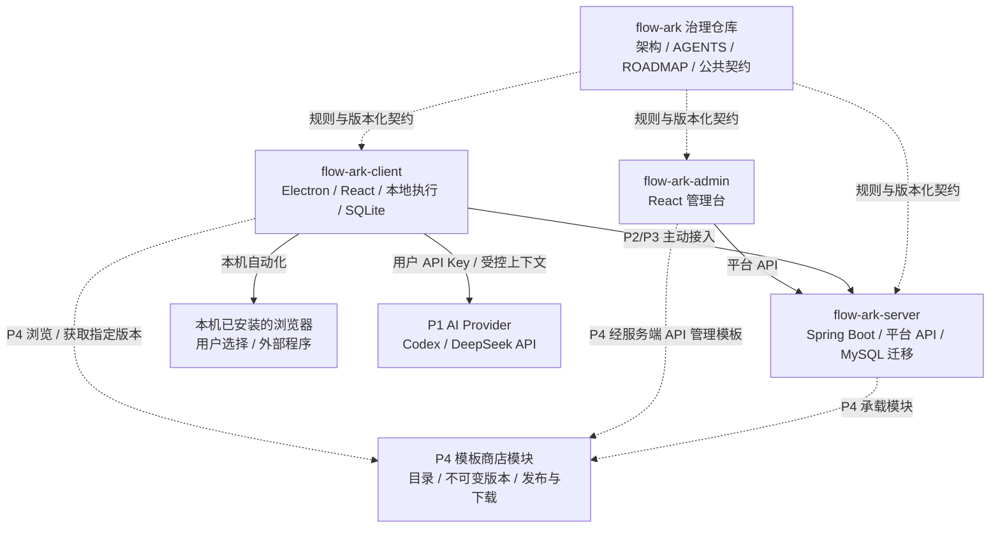
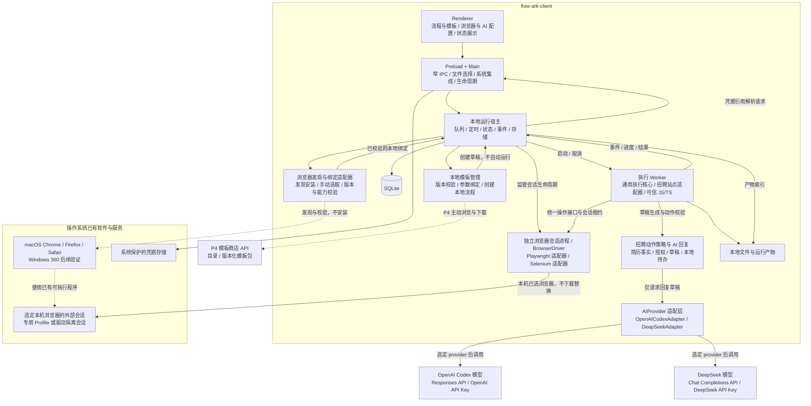
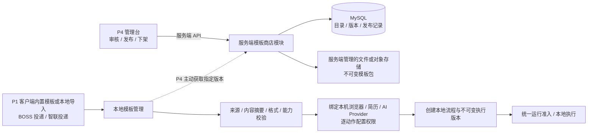
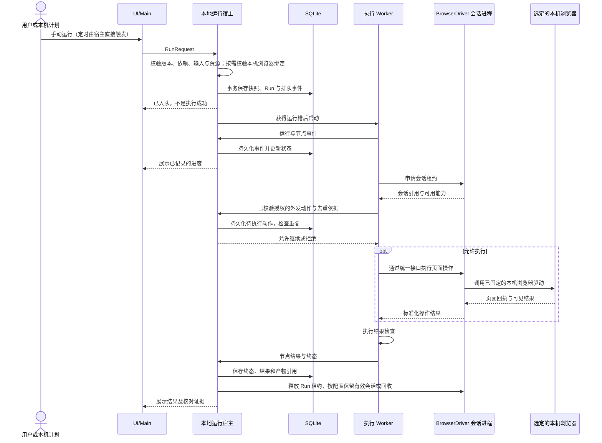
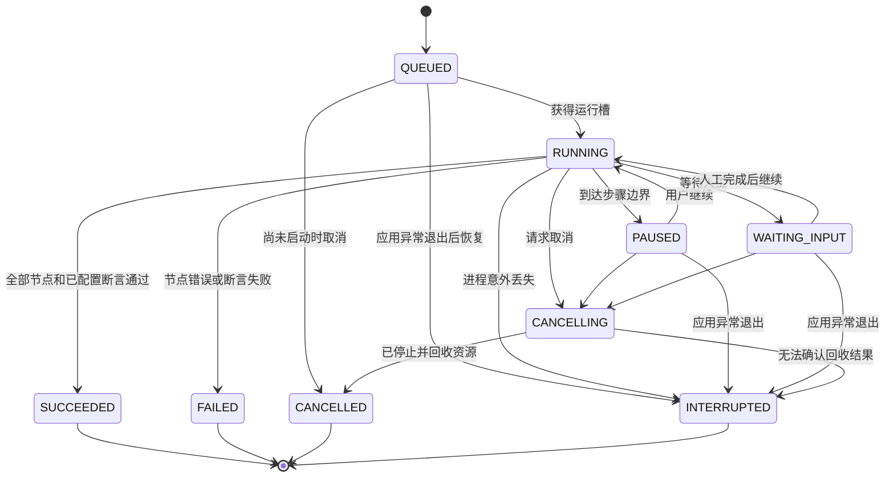
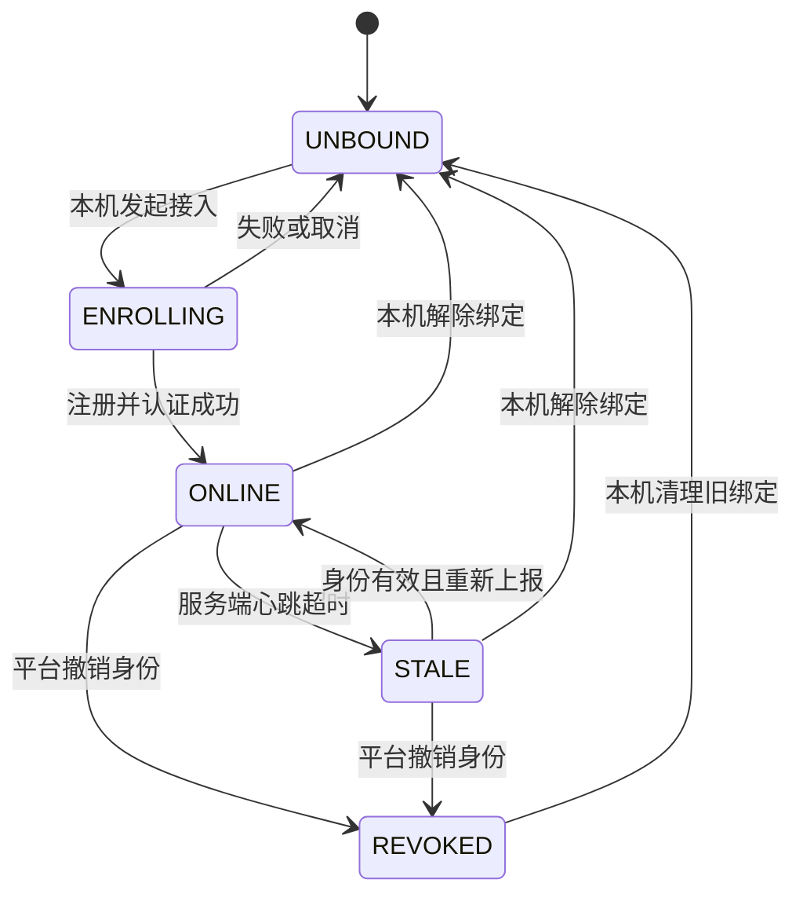

# FlowArk 总体架构

文档基线：P0，2026-09-16。状态：完整设计基线；P1 客户端开发预览及契约 0.7.0 已建立，实际完成范围见 ROADMAP。平台尚未实现，招聘闭环未验收。

本文是完整架构的唯一来源。[ROADMAP](../ROADMAP.md) 记录阶段与验收，[AGENTS.md](../AGENTS.md) 规定开发约束，[契约说明](../contracts/README.md) 规定协议版本与消费者管理。

P1 的招聘业务配置、AI 回复、动作授权和验收详见 [招聘交互验收](p1-recruiting.md)。当前先完善 macOS；Windows 360 浏览器后续单独验证。

2026-09-18 当前测试优先级：所有浏览器测试统一采用内置面板，先验证复杂表单，BOSS/智联校准暂停；本机浏览器保留兼容能力，不在本轮自动测试。

2026-09-18 编辑体验增量：参考用户提供的影刀产品演示，先补齐内置网页元素拾取、可读动作配置和编辑到调试的闭环，见 [元素拾取约定](client/element-picker.md)。沿用现有流程图语义与 BrowserDriver，录制、AI 生成及在线商店仍独立后续推进，不将产品演示视为本产品实现或稳定性证据。

2026-09-20 网页显示调整：按用户要求将内置网页默认布局宽度固定为 1920 CSS 像素，右侧面板等比缩放展示，高度随可视区域调整；网页坐标与显示坐标分离。采用和验收规则见 [内置浏览器](client/embedded-browser.md)，不改变 BrowserDriver 或公共流程协议。

2026-09-20 编排体验复核：影刀 6.0 视频中的具体动作入口、可读参数与流程修改用于检视当前编辑器，见 [产品参考与差距](client/product-reference.md)。先处理网页展开时的画布可见性，再完善动作发现、插入与配置；这不改变已有流程语义、右侧内置网页或 P1 阶段边界。

2026-09-18 调整：按用户要求增加可选内置浏览器，以 FlowArk 主窗口右侧网页面板执行，收起或最小化工作台后继续运行。原本机浏览器模式保留，已有绑定不迁移、不静默切换。详细边界见 [内置浏览器](client/embedded-browser.md)。

2026-09-17 推进顺序调整：先通过无需账号的简单测试网站打通通用浏览器操作、条件判断、文件产物和重复运行，再完善恢复与交付。Codex 配置及真实调用由用户后续安排；招聘投递保留为最终效果，生产站点适配与真实业务验收后置。此调整不删除既有能力或放宽最终验收，也不让招聘账号、Codex Key 阻塞当前通用阶段。

2026-09-16 补充决定：通用编辑器右侧仅保留节点、参数和本机资源绑定；业务配置由模板包的 Schema 声明，通过独立实例表单呈现，不把 BOSS/智联字段写死在通用编辑器中。契约 0.2.0 将表单与流程共同纳入摘要；导入初始化安全配置，实际值只在本地实例保留，未来商店沿用此边界。所有设计、契约采用、开发约束与验收 Markdown 归治理仓库，应用只保留 README、贡献指南等必要说明。

2026-09-16 编辑器补充：按 [流程图语义](client/flowchart.md) 使用条件菱形、数据平行四边形、人工梯形、文档等形状，显式展示条件汇合和串行循环回边。沿用 React Flow 自定义节点；开始/结束及汇合点仅属渲染投影，不进入持久化流程，不新增执行节点或任意回路。

## 1. 产品目标与阶段边界

FlowArk 是本地优先、可扩展的自动化工作台。用户通过可视化节点和可信自定义脚本，将数据处理、文件生成、浏览器操作和业务结果检查组合为流程。

| 阶段 | 交付目标 | 不据此承诺的能力 |
| --- | --- | --- |
| P0 | 多仓库治理、架构、开发约束、路线图 | 可运行客户端、可用协议、安装包 |
| P1 | macOS 优先的单机招聘交互，通用编排、AI 回复、手动和本机定时执行；Windows 兼容后续验证 | 服务端、管理台、远程派发、桌面自动化 |
| P2 | 单组织私有部署平台，集中监控设备与运行 | 远程执行或终止、平台调度 |
| P3 | 发布流程版本、设备授权、远程派发和治理 | 任意远程 Shell、任意本地文件访问 |
| P4 | 模板商店；按需增加 Python、OCR、桌面操作、录制、插件、独立代理 | 一次实现全部扩展或自动跨平台兼容 |

P1 正式验收：在本机按配置操作 BOSS 直聘和智联招聘求职者网页版，完成 **职位筛选 → 选定简历投递/发送 → AI 回复 → 微信/手机号交换 → 对方微信号提醒与结果核对**。macOS Chrome 先打通，Firefox/Safari 随后分别验收；Windows 360 不阻塞首个 macOS 版本。不部署 FlowArk 平台也必须可以运行；业务网站以及用户选择的云端 AI 仍依赖相应网络。

原“HTTP → JS/TS → Excel → 上传 → 核对”保留为通用引擎回归样例，不能替代招聘平台验收。招聘规则放在业务模块和站点适配器中，不耦合进通用执行核心。

P1 首批本地模板为“BOSS 直聘投递简历”和“智联招聘投递简历”，AI 聊天首版支持 Codex 和 DeepSeek，均使用用户自己的 API Key。P4 再建设在线模板商店，P1 使用模板不依赖商店或平台。

## 2. 仓库组织与技术方向

`flow-ark` 是治理仓库和本地工作主目录。`flow-ark-client`、`flow-ark-server`、`flow-ark-admin` 是被主仓库忽略的独立子仓库，不使用 submodule。

图中治理连线表示设计和发布依赖，不是运行时调用。应用运行、构建、测试不能要求相邻仓库存在。

模板商店属于服务端模块，管理台提供发布管理界面、客户端提供浏览与安装入口，不另建商店仓库。AI API 由客户端直接调用，与 FlowArk 平台连接分开。

| 层次 | 选型 | 归属 |
| --- | --- | --- |
| 客户端界面 | Electron、React、TypeScript、React Flow、Monaco | 客户端仓库 |
| 自动化和文件 | 统一 BrowserDriver：playwright-core＋selenium-webdriver；JS/TS、ExcelJS | 客户端仓库的适配器，业务层不依赖库对象 |
| 自动化浏览器 | macOS Chrome/Firefox/Safari；Windows 三款 360 后续逐款验证 | 用户选择系统已有软件或应用自带 Electron 内核；不额外下载浏览器 |
| 招聘业务与 AI | BOSS/智联网页适配、动作策略、AIProvider（Codex/DeepSeek）、联系方式提醒 | 客户端业务模块；用户自配 API Key，无需 FlowArk 服务端 |
| 模板 | P1 本地模板；P4 商店目录、版本、审核与发布 | 客户端管理本地实例；服务端/管理台管理商店 |
| 本地数据 | SQLite、独立文件目录、系统保护的凭据存储 | 客户端仓库 |
| 平台服务 | Spring Boot、MySQL、模块化单体 | 服务端仓库 |
| 管理台 | React、TypeScript | 管理台仓库 |
| 协议 | JSON Schema、OpenAPI、脱敏示例 | 治理仓库 |

客户端和管理台分别使用 pnpm 与各自锁文件；服务端使用 Maven。主目录不建立跨仓库 pnpm workspace。客户端可以在自身仓库内部组织多个包，执行核心暂不拆成第四个应用仓库。

SQLite 迁移由客户端发布，MySQL 迁移由服务端发布，不建立数据库专用空仓库。P2 不引入微服务、SaaS 多租户、计费、Redis 或消息队列作为基础前提。

具体依赖版本与目标系统最低版本在各应用首次建工程时验证并锁定，不使用 P0 文档虚构“最新兼容版本”。P1 当前优先 macOS，Windows 及三款 360 保留后续独立验证项；未验证平台不得宣称可用。旧 Windows、IE/360 兼容模式和 Linux 不在本轮承诺中。

## 3. 客户端进程与模块边界

Main 启动和监督本地运行宿主，宿主启动每次运行的 Worker。P1 单设备最多运行一个 Worker；Electron 专属进程启动与通信放入宿主适配层，不污染执行核心。首次实现可以用 Electron utility process 承载本地宿主，但其业务模块保持可由其他 Node 宿主加载。

本机浏览器会话由本地宿主管理的独立会话进程持有；内置模式由宿主经受控系统接口租用 Main 中的隔离网页视图，Worker 通过统一接口申请/释放会话租约，不直接持有库对象。一个正常结束的消息检查批次可释放运行槽并保留仍有效的受控登录会话，供后续批次使用；取消未完成浏览器操作、用户退出或会话失效时回收对应自动化资源。会话不能被两个 Run 同时操作，也不承诺 Safari 在会话中断后可恢复。

图中的外部浏览器仍是用户选择的系统已有程序。2026-09-18 新增的内置模式由 Main 持有独立 WebContentsView，复用应用随附内核；网站 Renderer 不加载工作台、凭据桥或数据库。仍经宿主租约和统一 BrowserDriver 使用，不作为外部浏览器失败后的备用执行环境。

| 模块 | 允许职责 | 禁止依赖或行为 |
| --- | --- | --- |
| Renderer | 编辑、表单、日志与进度展示 | 直接读写 SQLite/文件、读取凭据、启动进程或执行脚本 |
| Preload | 暴露明确方法及事件订阅 | 将完整 ipcRenderer、任意 channel 或原生对象交给界面 |
| Main | 系统窗口、文件选择、安全存储桥接、宿主生命周期 | 执行流程、业务节点、分支循环或定时业务逻辑 |
| 本地运行宿主 | 运行准入、队列、调度、事件和状态持久化、统一存储写入 | 在界面中直接暴露数据库，执行耗时用户脚本 |
| 浏览器发现与绑定适配器 | 枚举本机安装、校验手动选择、保存本地绑定和检测能力 | 下载、安装、替换浏览器，修改系统默认浏览器或静默改用其他安装 |
| BrowserDriver/会话管理 | 统一页面操作、驱动能力探测、会话租约、驱动及浏览器资源回收 | 向业务暴露 Page/WebDriver、在业务提交后切驱动重放 |
| 招聘策略与站点适配 | 按配置筛选、准备/核对动作、平台页面差异、待办提醒 | 把站点选择器写入通用核心，绕过动作授权 |
| AI 回复服务 | 基于已授权的简历事实和对话生成草稿 | 直接操作浏览器或发送消息、编造经历、扩大授权 |
| AIProvider 适配层 | Codex/DeepSeek 的请求、响应、能力、超时与取消归一化 | 密钥返回 Renderer、把 Codex 登录当 API Key、静默切换供应商 |
| 本地模板管理 | 校验模板版本、展示能力要求、绑定参数、创建本地流程；P4 获取商店模板 | 下载即执行、夹带账号与授权、覆盖已有流程或运行快照 |
| 执行核心 | 状态与控制流、输入输出、节点调度、取消传播 | React、Electron UI、平台 HTTP 客户端、具体 SQL 驱动 |
| 能力适配器 | 实现 Browser/HTTP/File/Excel/Script 等能力 | 绕过宿主修改运行记录或自行宣布平台任务完成 |

Renderer 配置 `contextIsolation: true`、`sandbox: true`、`nodeIntegration: false`。主进程校验 IPC 来源、方法和参数；文件操作用明确的业务接口，不暴露“执行任意命令”桥。业务网站运行在用户选定的本机浏览器实例或独立内置会话中，经 BrowserDriver 控制。内置远程页面不加载 preload，不暴露工作台 IPC，不作为拥有本地权限的客户端 UI 加载。[Electron 安全指南](https://www.electronjs.org/docs/latest/tutorial/security)

Worker、脚本和会话进程分别登记资源归属并可取消回收；异常取消须停止该 Run 的浏览器操作并释放或销毁其受控会话，不能只杀 Worker 留下失控驱动。用户脚本不能与 Renderer 或主进程同进程执行；独立进程只提供故障与生命周期隔离，不是对恶意代码的安全保证。Node `vm` 不作为安全沙箱。[Node.js VM 文档](https://nodejs.org/api/vm.html)

## 4. 流程、节点和脚本模型

### 4.1 流程定义与执行版本

- 草稿可编辑，运行前校验并生成不可变执行快照；手动运行和定时运行都绑定该快照。
- 定时任务固定引用某个版本，更新草稿不会改变已启用计划；用户更新计划时显式选择新版本。
- 2026-09-20：本机计划提供周期/时区编辑，保留启停状态和默认固定版本；采用新版本需明确选择，异步预检不得覆盖并发启停或草稿变更。接口与兼容见[计划显式更新](client/schedule-editing.md)，不改变间隔调度语义。
- `FlowDefinition` 描述执行语义，画布坐标、颜色、折叠状态属于独立编辑元数据。禁止将 React Flow 原始状态直接当成唯一执行协议。
- P1 支持顺序、条件、串行循环。循环必须使用显式容器，输入为集合或明确次数；不支持任意回边、并行分支和可复用子流程。
- 条件分支结果显式汇合；循环变量在迭代作用域内，跨节点数据通过输出引用传递。运行前校验不存在的引用和作用域越界，不依赖共享可变全局变量。
- 普通配置只使用明确的数据引用与条件操作，不通过 `eval` 执行表达式；复杂逻辑交给显式脚本节点。
- 活跃浏览器、进程、函数不能写入流程 JSON；文件用 `ArtifactRef`，浏览器会话用运行期引用，凭据用 `CredentialRef`。

### 4.2 P1 节点与 SDK

| 能力 | 最小行为 |
| --- | --- |
| HTTP | 请求业务数据，区分网络异常、HTTP 错误和业务结果 |
| JS/TS | 执行可信脚本，输入输出、日志、主动进度、取消；TS 在执行前编译 |
| Excel | 读取/写入普通工作簿与模板，记录文件产物；宏及高级公式计算不作为 P1 保证 |
| 文件 | 在用户选择或任务配置的范围内读写、归档，记录产物引用 |
| 浏览器 | 使用已绑定的本机浏览器启动会话、定位、点击、输入、等待、读取、上传、下载业务文件和截图 |
| 结果断言 | 校验回执、状态或数量，业务不符合预期时失败 |
| 等待人工 | 等待用户处理登录/验证码或作出流程需要的输入，再继续 |
| 条件/循环 | 基于明确输入执行分支或串行迭代，记录节点实例与迭代位置 |

脚本接口包含 input、输出结果、logger、progress、artifact、credential 和取消信号等职责。函数命名和准确字段在 P1.1 契约中固定；不得伪装成现有 SDK。所有节点与脚本共享运行上下文和同一事件入口。

脚本依赖在运行前解析并固定，版本与依赖清单随执行快照记录；执行中不自动联网安装。P1 先提供内置 SDK 和经用户配置、验证的本地依赖，不建设插件市场。必要资源缺失时在启动前阻止运行，并给出明确原因。

2026-09-16 固定方式：用户绑定已安装包的目录并声明精确版本；创建 Run 或计划版本前静态打包为按摘要寻址的文件，版本与快照保存摘要和解析清单，排队后及脚本执行前核对产物完整性。计划继续使用已固定内容，重新保存计划才采纳依赖变动。依赖目录不进入模板或公共协议；动态加载、原生扩展和运行时资源的支持边界见 [本地脚本依赖](client/script-dependencies.md)。

脚本应主动报告业务进度，例如已处理数和总数。没有报告时展示当前节点、耗时和日志，不推算虚假的百分比。分支和循环流程的节点数量不能直接当成业务完成率。

### 4.3 本机浏览器选择与人工接管

**网页自动化显式选择“本机浏览器”或“内置浏览器”。** 本机模式的安装和版本维护由用户或其 IT 环境负责；内置模式使用随 FlowArk 发布的 Electron 内核，不额外安装 Chromium，也不使用 Playwright 浏览器缓存。两种模式不能在失败后静默互换。内置模式细节、后台与休眠边界见 [内置浏览器](client/embedded-browser.md)。

浏览器目标和驱动路线如下，均为需要验证的设计，不是已经通过的支持清单：

| 系统/浏览器 | 优先路线 | 验证与推进边界 |
| --- | --- | --- |
| macOS 内置浏览器 | 隔离 WebContentsView＋本地 debugger 适配器 | 新增验证目标；不等同于系统 Chrome 验收 |
| macOS Chrome | PlaywrightAdapter（playwright-core） | 当前首个完整业务验收目标 |
| macOS Firefox | SeleniumAdapter＋geckodriver，指定本机 Firefox | P1 后续兼容验收；不使用 Playwright 修改版 Firefox 替代 |
| macOS Safari | SeleniumAdapter＋系统 safaridriver | P1 后续兼容验收；先验证启用条件、隔离登录、扫码/验证码和人工接管 |
| Windows 360 安全浏览器 | 极速内核先验证 Playwright；必要时 Selenium＋匹配 ChromeDriver | 后续单独验证，记录产品/内核版本，兼容/IE 模式不沿用此路线 |
| Windows 360 极速浏览器 | 同上，独立验证 | 不能用安全浏览器或极速 X 的结果代替 |
| Windows 360 极速 X | 同上，独立验证 | 当前不阻塞 macOS 首个版本 |

Chrome/Edge 或其他 Chromium 可作为兼容诊断基线，但不能偷偷替代用户指定的浏览器。360 有极速/兼容模式差异，不能仅凭浏览器品牌推断当前页面可被哪种驱动操作。[360 官方帮助](https://browser.360.cn/se/help/browser.html)

Playwright 可以指定外部可执行程序，但官方不保证任意外部版本；Chromium 的 CDP 连接亦有能力限制。因此 360 是待测候选，不是天然不支持，也不是已保证支持。Selenium 可配置浏览器 binary，但仍需验证内核/驱动匹配与页面功能，不能把“换 Selenium”视为兼容证明。[Playwright BrowserType](https://playwright.dev/docs/api/class-browsertype)、[ChromeDriver 配置](https://developer.chrome.com/docs/chromedriver/capabilities)

Playwright 的 Firefox/WebKit 使用其所需的定制构建，不能把 WebKit 测试当作本机 Safari 验收。使用系统 Firefox/Safari 的要求使 Selenium 成为 P1 的必要适配器，而不只是 360 的备用方案。[Playwright 浏览器说明](https://playwright.dev/docs/browsers)、[Selenium Firefox](https://www.selenium.dev/documentation/webdriver/browsers/firefox/)、[Selenium Safari](https://www.selenium.dev/documentation/webdriver/browsers/safari/)

选择与启动流程：

1. 用户可启用应用内置模式，绑定固定 ID 与应用内核版本；旧绑定保持不变。本机浏览器适配器从 Windows 安装信息、macOS 应用目录等本机来源发现候选项，显示名称、版本、安装位置和可用状态；不只读取系统默认浏览器。
2. 用户从候选列表选择，也可通过系统文件选择器手动指定已有可执行文件或 macOS 应用；适配器解析真实可执行路径并验证浏览器身份、版本和所需能力，不把任意程序当成浏览器运行。
3. 选择结果保存为本地浏览器绑定。流程只引用绑定或浏览器能力要求；绝对安装路径不写入可移植流程，也不上传平台。导入流程或在另一设备运行时重新绑定。
4. BrowserDriver 在副作用发生前，根据能力验证结果选择并固定驱动：Playwright 明确传 `executablePath`；Selenium 显式配置本机 browser binary 和 driver service；Safari 使用系统 Safari/safaridriver。不得回退到下载版、缓存浏览器或另一品牌，也不得在投递/回复失败后换驱动重放。
5. 运行前重新校验路径、浏览器和驱动版本、模式、能力及会话。卸载、移动、系统更新导致不兼容或无法启动时，阻止需要浏览器的流程并提示处理；纯数据和文件流程不因浏览器缺失被阻止。验证不能只依赖首次安装时的结果。

客户端仅管理自己的浏览器自动化会话；支持持久化 Profile 的驱动使用专用目录，Safari 按系统 WebDriver 的隔离模型处理，不强行套用 Chrome Profile 或复制日常登录态。任务结束释放租约，登录会话可按配置保持；用户退出、异常取消或失效时关闭对应会话，不关闭用户已有的其他浏览器窗口。

Safari 需启用系统支持的自动化能力，其自动化窗口与普通窗口隔离，人工打断可能使会话永久失效。P1.1 先验证真实网站的扫码、验证码、登录和接管路径，不承诺“手动操作后一定能继续原会话”；不可恢复时保留待办并重新建立会话，绝不重放结果未知的发送动作。[Apple WebDriver 说明](https://developer.apple.com/documentation/webkit/about-webdriver-for-safari)、[WebKit 隔离说明](https://webkit.org/blog/6900/webdriver-support-in-safari-10/)

构建、打包、安装、首次启动和升级流程均不得引入自动化浏览器下载，也不添加 `@playwright/browser-*` 下载型依赖或执行 `playwright install`。测试环境同样使用预先安装、显式选择的浏览器；无浏览器的环境验证缺失提示，不靠临时下载掩盖依赖。Electron 运行时随应用分发，2026-09-18 起可由用户显式选为内置模式；不另带或下载第二套浏览器。

Selenium 的驱动程序与浏览器本体分开管理。使用 JavaScript 绑定，不因此引入 Python/JVM；ChromeDriver/geckodriver 由依赖准备步骤提供匹配并校验的本地路径，运行中不临时下载。使用 Selenium Manager 时必须禁用浏览器下载（如 `SE_AVOID_BROWSER_DOWNLOAD=true`）；Safari 使用系统驱动。驱动不存在或不兼容时提示处理，不让 Manager 默默安装另一个浏览器。[Selenium Manager](https://www.selenium.dev/documentation/selenium_manager/)

P1 不承诺接管任意已打开浏览器窗口。未来 CDP 连接适配器需独立定义限制；CDP 仅适用于 Chromium 系浏览器，能力与完整 Playwright 协议不同。[Playwright CDP 说明](https://playwright.dev/docs/api/class-browsertype#browser-type-connect-over-cdp)

等待人工后继续前必须复核当前账号、页面和会话能力；驱动无法恢复时进入明确的待处理状态。P1 不自动识别或绕过验证码，不将 RPA 或更换驱动描述为不会封号。

### 4.4 统一浏览器接口与招聘业务

BrowserDriver 覆盖会话与能力探测、导航/页面与框架定位、读取、点击、输入、文件上传、等待、截图、取消和关闭；业务脚本通过统一 SDK 使用这些能力。驱动差异以 capability 表达，不向流程或招聘业务暴露 Page/WebDriver 原生对象。某项能力缺失在执行前报告，不能用不等价的操作伪装成功。

2026-09-16 框架定位使用每条命令独立的 CSS 路径，从顶层逐层唯一匹配 iframe/frame，禁止缺失或歧义时回退。browser v2 承载路径，v1 保持顶层语义，旧快照不自动迁移；具体范围见 [浏览器框架](client/browser-frames.md)。

2026-09-17 表单控件增量使用 browser v3，增加原生选项选择、按目标状态勾选、输入值读取与限定按键。旧 v1/v2 和数据库不迁移；自定义控件按可见输入/点击建流程，不注入 DOM 值绕过限制。通过本地虚构接收端核对提交字段与上传内容，见 [复杂表单实验室](client/form-lab.md)。

招聘业务通过独立的 BOSS/智联 SiteAdapter 适配页面，使用 ActionPolicy 校验每类动作的禁止/确认/自动配置，AIReplyService 只产出基于用户简历事实和当前对话的草稿。站点消息不具有修改规则的权限；结果未知不自动重发。

两站的职位、账号、简历、对话、动作记录、交换结果和本地待办分别管理。投递、回复、请求或接受微信/手机号均独立授权。取得实际对方微信号后生成持久化提醒，包含平台、公司/职位、联系人、号码与来源；请求已发送或对方未同意不能当作已取得号码。具体配置、AI 数据范围、提醒去重与验收见 [招聘交互验收](p1-recruiting.md)。

持续沟通采用有限批次的本机计划，不让等待对方的请求长期占据单任务运行槽。业务待确认/等待对方与执行器的同步 `WAITING_INPUT` 区分：前者保存为待办并结束本轮，后者仅用于需要保持现场的短时人工介入。

### 4.5 AI 聊天首版：Codex 与 DeepSeek

首版使用统一 `AIProvider`，由本地 AI 回复服务调用；招聘模板和执行核心不直接依赖供应商 SDK。这里的 Codex 按用户明确选择，指 **OpenAI API Key 调用 Codex 模型**，不依赖 Codex CLI、桌面应用或其登录态。

| Provider / 适配器 | 首版接入方式 | 本地配置与验证 |
| --- | --- | --- |
| `openai-codex` / OpenAICodexAdapter | OpenAI Responses API，`POST https://api.openai.com/v1/responses` | OpenAI API Key 引用、可用 Codex 模型 ID、经验证的模型参数 |
| `deepseek` / DeepSeekAdapter | DeepSeek Chat Completions API，`POST https://api.deepseek.com/chat/completions` | DeepSeek API Key 引用、可用模型 ID、经验证的模型参数 |

按官方协议分别构造和解析请求，不强制把 Codex 接入改写为 Chat Completions。具体模型 ID 和依赖版本在 P1.2 验证并记录，不能假设所有账户都可访问某个模型，也不以品牌名替代真实模型 ID。[OpenAI Codex 模型说明](https://developers.openai.com/api/docs/models/gpt-5.3-codex)、[DeepSeek API 说明](https://api-docs.deepseek.com/)

`AIProvider` 接收限定的简历事实、岗位和当前对话，返回统一的草稿、实际 provider/model、请求标识及可用的用量信息；未返回的用量保持未知。模型参数、结构化输出和流式能力按所选模型探测；不把流式片段、推理内容或未完成结果直接发给招聘联系人。返回内容必须完整且通过草稿 Schema、事实与动作策略校验。

API Key 经系统保护的存储保存，设置界面仅提供写入/替换和掩码状态；实际调用在客户端非 Renderer 的能力层执行。两家密钥独立绑定，不写进模板、日志、导出或平台。P1 不提供平台代付、平台代理或自动跨供应商降级；切换 provider/model 由用户配置，变更后废弃未发送的旧草稿并重新校验。

AI 云端调用仍需网络；“单机版”仅表示不依赖 FlowArk 平台。首版仅验收上述两种接入，本地模型和其他兼容服务保留后续适配边界。AI 只生成内容，不启用模型的浏览器、Shell、文件或外发工具。

### 4.6 本地模板与后续模板商店

模板是可复用的流程起点，组合已有节点、站点适配器、参数表单和提示词；它不是正在运行的任务，也不自带执行权限。首批模板分别为 `boss-resume-apply`（BOSS 直聘投递简历）和 `zhaopin-resume-apply`（智联招聘投递简历），可按配置启用 AI 回复及联系方式交互，仍遵守逐动作授权。

P1.2 在客户端仓库维护首批模板，P1.3 支持模板包导入导出并校验；治理仓库只维护格式与虚构示例。P4 模板商店首期复用单组织平台：服务端管理目录、分类、模板版本与包分发，管理台负责审核、发布、下架及审计，客户端负责浏览、下载、校验和创建本地流程。模板商店与 P3 远程任务派发是两个入口，下载不产生 Run 或远程执行授权；首期不引入付费结算或公共多租户市场。

边界约束：

- `TemplateManifest` 最少声明模板 ID、不可变版本、来源、内容摘要、流程格式、参数 Schema、所需节点/站点适配器版本、浏览器/AI 能力以及脚本和依赖清单。模板只能声明需求和非敏感默认值，不能绑定用户真实账号、简历、联系方式、API Key、绝对路径或默认授予自动发送权限。
- AI Provider、模型及其接口地址由用户本地配置绑定，模板和提示词不能改写接口地址或静默换供应商。
- 模板包只含流程、提示词、参数定义、声明的脚本与静态资源，不夹带浏览器、模型、驱动、可执行安装器或任意依赖包。新增节点或驱动仍由客户端/未来插件的独立发布流程交付，不能借模板绕过升级与信任边界。
- 获取模板先校验可信来源、包摘要、格式和能力；摘要校验不等于代码可信。含脚本的模板明确展示代码与依赖，不自动运行安装钩子或脚本。能力缺失时阻止创建可运行版本并提示处理。
- 创建的本地流程记录来源模板 ID、版本和摘要；模板只提供起点，本地流程和配置由用户管理。后续商店更新显示差异，由用户采用新版本，不能覆盖本地修改、已有计划、活动 Run 或继承新内容未获准的自动动作权限。
- 平台发布的 `FlowVersion` 仍按 P3 不可变版本和设备授权治理；模板实例化不自动变成平台发布或设备授权。商店下架阻止新获取，不远程删除本地流程或终止任务；已获取版本可在不连接商店时使用，网站与 AI 调用仍需网络。

本地首批模板、模板包格式与在线商店分别验收；P1 不实现商店登录、目录服务、审核或在线分发。

## 5. 本地执行、状态与可靠性

### 5.1 从提交到完成

图中以浏览器外发动作为例；纯 HTTP、文件等节点调用各自能力适配器，不申请浏览器会话。调度与 UI 走同一运行准入入口。宿主是 SQLite 的统一写入方，Worker 通过消息请求持久化和发送事件。快照、初始记录和入队事件成功持久化后才能启动；终态持久化后才能对外报告已记录的完成。

状态和事件保持一致，不让 Worker 直接改数据库。宿主无法持久化时停止接收新运行，并报告本地故障；不得继续显示任务已可靠保存。已执行外部操作但尚未落盘的结果按未知处理。

### 5.2 运行状态

下面是 P1 的逻辑状态，正式 wire 枚举由 P1.1 Schema 固定，含义不得悄悄变化。

- 暂停请求在下一步骤边界生效，不承诺冻结任意脚本指令；等待人工和暂停期间仍占用运行槽及已持有的浏览器资源。
- 节点超时或已捕获异常记录失败；进程意外丢失、无法确认执行进度记录中断。异常恢复不自动重新执行排队或活动任务。
- 取消先传递协作信号，超过明确配置的宽限期后终止进程树；只有确认资源回收才记为已取消。
- 取消、中断、节点失败都不能证明外部操作没有生效。涉及提交的节点要保留回执或标记业务结果待核对。
- `SUCCEEDED` 表示流程中所有实际执行的节点和已配置检查通过；未配置业务检查时，不能宣称外部业务已验证成功。UI 同时表达执行结果和业务核对状态。
- P1 不做崩溃后的脚本内部续跑。用户核对后重新运行会产生新的 Run，并保留与原 Run 的关联。

### 5.3 调度、并发和副作用

- P1 每设备一个运行槽，手动任务 FIFO 排队。被暂停或等待人工的任务不会让出槽位。
- 本机定时仅在应用驻留时生效。计划记录时区和预期触发时间；同一触发时刻只能生成一次任务。
- 同一定时计划已有排队或运行实例时跳过本次触发，并记录占用原因，不积累同一任务的待执行副本。
- 退出、休眠期间的计划不补跑。恢复时记录错过的时间范围或次数，计算下一次未来触发，不伪造历史 Run。
- 关闭窗口进入托盘；显式退出停止调度，清楚提示受影响的运行，按取消规则处理活动任务并取消尚未执行的队列。
- 不自动设置开机启动或安装系统服务，应用退出后不会继续定时执行。
- 默认无自动业务重试。查询等可重复节点允许显式配置有限重试；提交、发布、上传后的业务确认等节点需要幂等证明或先核对状态，不能盲重试。
- 浏览器 Profile、未来桌面鼠标键盘等资源通过资源管理接口申请；不得由节点自行突破单任务约束。

## 6. 本地数据与安全存储

以下是逻辑数据集合，不是已经实现的表名或 DDL。P1.1 制定具体模型与迁移后再建立数据库。

| 数据 | 保存方式与归属 |
| --- | --- |
| 本地安装标识、设置 | SQLite；安装标识不等于未来平台设备 ID |
| 本机浏览器/驱动绑定、路径、模式和检测结果 | SQLite；本地配置，执行前重新校验，不进入可移植流程或平台上报 |
| 流程草稿、不可变版本、编辑元数据 | SQLite；语义和展示分开 |
| 本机计划、触发记录、跳过记录 | SQLite；保存版本引用、时区和触发依据 |
| Run、节点实例、迭代位置、RunEvent | SQLite；事件与状态由宿主统一写入 |
| 日志与产物元数据 | SQLite 保存索引；较大文件位于每次运行的产物目录 |
| Excel、下载文件、截图 | 本地文件目录；由 ArtifactRef 标记归属和内容信息 |
| 浏览器 Profile、登录态 | 支持持久化 Profile 的驱动使用专用本地目录；Safari 遵循驱动隔离会话，不承诺持久化复用；不放流程 JSON、不提交或默认上传 |
| 业务凭据与未来设备令牌 | 系统安全存储，或经系统能力保护的加密存储；SQLite 仅保存引用 |
| 招聘配置、简历事实、对话与动作记录、交换结果、提醒 | 本地业务存储；敏感内容受保护，通用日志脱敏，默认不上报；动作与提醒可持久化去重 |
| AI 接口和模型配置 | 本地配置；API 密钥仅用 CredentialRef，调用范围由用户配置，不依赖 FlowArk 服务端 |
| 本地模板包、来源版本与实例化记录 | 模板包放本地文件目录，SQLite 记录摘要、版本与本地流程关系；业务绑定不回写共享模板 |

数据目录位于用户数据区，不放源码仓库。运行产物按 Run 隔离，支持历史保留和清理；不能在仍需核对结果时无提示删除证据。2026-09-20 修正登记可变业务输出路径的问题：新产物每次登记保留独立副本和摘要，旧记录明确标为未保存副本；兼容与取消/失败规则见[运行产物副本](client/artifact-snapshots.md)。2026-09-20 增加按 Run 显式预览并确认的[产物清理](client/artifact-cleanup.md)，保留历史索引、执行事件和外发去重记录，清理失败及中断不得冒充完成。

2026-09-20：历史访问采用本地有界分页和名称/ID、状态/来源筛选，活动状态及每个流程最近结果从完整记录计算，不受当前历史页影响；接口与兼容约定见[运行历史](client/run-history.md)。

数据库迁移由本地宿主启动时执行并校验。破坏性结构变更提供备份和迁移说明；迁移失败时阻止新的运行，不能删除数据库“自愈”。升级后的历史数据和进行过业务提交的记录都必须可核对。

凭据读取经受控桥接按引用解析，明文不返回 Renderer，平台不持有浏览器登录态。系统安全存储不可用时阻止相关凭据能力，不能明文降级。

数据密钥仅在密钥文件确实不存在时创建；保护后端或解密错误不得触发换钥，损坏密文保留并报告错误。0.1.5 修复错误分类，不改变加密格式或迁移旧数据，验证见 [凭据存储故障处理](client/credential-storage.md)。

日志、异常和上报共用脱敏策略。任意可信脚本仍可能打印业务秘密，因此不能将自动脱敏宣传为绝对防泄漏。截图只在可采集时保存；采集失败不能掩盖原始错误。

导入导出包含流程、版本化脚本/依赖声明及显式选择的模板资源；默认排除凭据、登录态、运行历史和完整本地路径内容。导入后校验格式、能力和依赖并重新绑定本机资源，不自动执行导入脚本。

## 7. 跨系统数据归属与平台职责

| 对象 | 权威来源 | 平台与设备的关系 |
| --- | --- | --- |
| 本地草稿、流程、本机计划 | 客户端 | 默认留在本地；上传或纳入监控须有明确设置 |
| P4 商店目录、模板发布版本和包 | 服务端 | 管理台经 API 管理；客户端取得指定版本后创建自己管理的本地流程，不自动上传个人配置 |
| 平台发布的流程版本 | 服务端 | 设备只缓存不可变执行副本；本地修改另存为本地流程 |
| 平台任务与平台计划 | 服务端 | 设备接受后产生实际 Run；平台任务不能替代执行证据 |
| Run 实际事件和业务结果 | 执行设备 | 服务端通过事件投影形成监控记录，接收时间与发生时间分开保存 |
| 用户、角色、设备分组、授权审计 | 服务端 | 管理台通过 API 操作，服务端实施权限校验 |
| 本地凭据与浏览器登录态 | 客户端 | 平台只引用需求和绑定状态，不同步明文或 Profile |
| 运行附件 | 客户端产生 | 明确开启后上传副本；服务端使用自身附件标识，不能解析本地绝对路径 |

MySQL 和 SQLite 各自服务本端业务模型，禁止全库同步。平台端存储的状态是观察或管理视图，不通过写 MySQL “纠正”设备实际结果。

平台角色至少区分管理员、操作员、只读观察者。P2 管理员可管理账号和设备接入，观察者只读；P3 操作员在授权范围内发布/派发或取消，所有权限由服务端校验并审计。平台角色不替代设备对具体版本的本地授权。

P2 采用单组织私有部署：一个平台实例服务一个组织，设备与数据归属该平台。不建设租户切换、跨组织共享或 SaaS 配额。平台 API 与管理台可由同一部署入口提供，管理台仍是独立构建的仓库。

## 8. 设备接入、监控与远程治理

### 8.1 P2：接入与监控

设备经本机用户主动接入，平台验证一次性注册凭据并签发可撤销的设备身份。业务账号凭据与设备连接身份分开；设备令牌存入本地安全存储，不绑定某次浏览器登录。

一个安装同一时间只绑定一个平台。解除绑定或切换平台时，旧平台待上传事件、令牌和命令按旧绑定隔离，不能误发给新平台；本地流程与运行历史仍保留。

设备主动通过受认证的 HTTPS 接口注册、心跳与批量上报，不要求用户电脑开放入站端口。P2 先用心跳和批量事件接口实现监控，管理台通过服务端查询；无需为预留能力先建立长连接基础设施。

设备连接状态示意：

`ONLINE/STALE` 是平台根据接收情况判断的连接状态，不是 Run 状态。设备是否忙碌、等待人工、失败是另一维度。平台不能从失联推断断电、断网或程序故障的具体原因。

P1 先建立本地运行事件；P2 增加按绑定隔离的待上报队列与确认游标。事件允许重复投递，使用绑定身份、Run 标识和事件序号去重，确认持久化后才能推进游标。乱序到达不能覆盖更新的状态，缺口保留为待补齐，终态不因迟到旧事件退回运行中。

本地运行仅按启用的监控范围上传必要元数据；日志、截图、文件等附件单独配置。P2 没有远程启动、取消或平台计划，管理台只能观察实际运行。

### 8.2 P3：发布、授权与命令

平台发布流程版本后，设备下载并检查完整内容与能力要求。本地用户授权以下组合：流程版本及内容摘要、脚本与依赖声明、需要的凭据绑定、允许的参数范围。任一执行内容变化需要新版本和重新授权。

凭据引用只能使用该版本已批准的绑定，平台任务不能通过参数替换为任意凭据、文件路径或脚本。参数约束是运行准入条件，不是对恶意代码的沙箱。

设备继续主动使用认证 HTTPS 请求拉取命令并提交回执。命令至少关联唯一标识、目标设备、任务、流程版本和有效期；准确 wire 字段在 P3 契约中定义。

命令处理顺序：持久化收到记录 → 验证目标、版本、授权、参数、能力和有效期 → 持久化接受或拒绝 → 入队 → 开始执行 → 记录实际结果。命令与 Run 的创建关联必须原子记录，重复命令返回既有处理记录，不生成第二个 Run。

设备存储的去重信息需要覆盖命令可重投的有效窗口。设备丢失去重数据或业务执行结果不明时不得自动重跑。协议层去重不承诺外部业务副作用“恰好一次”。

平台取消命令只表示请求，必须等待设备确认执行与回收结果；离线时显示待送达。平台端身份撤销阻止后续连接和新命令，不宣称能立即终止断网设备上已经开始的任务。

断网期间已开始的任务继续按本地规则运行，新远程任务不能凭空启动；重连后补报实际结果。平台不因超时自动转派可能已提交业务的任务；核对后重试建立新的任务记录和明确关联。

本机计划和平台计划分别管理，各自引用确定的流程版本，不自动互相转换；本地和远程任务进入同一个设备资源管理与执行入口，远程任务不能抢占正在执行的本地任务。

## 9. 公共接口与演进原则

以下名称表示职责边界，不表示 P0 已存在可调用 API。

| 契约 | 最小职责 | 首次落地 |
| --- | --- | --- |
| FlowDefinition / FlowVersion | 格式版本、节点、控制结构、输入输出、能力要求、不可变执行内容 | P1.1 |
| NodeDefinition | 节点类型与版本、配置与输入输出描述、能力要求 | P1.1 |
| NodeExecutor | 执行上下文、结果、事件、取消；属于运行接口，不是可序列化函数 | P1.1 |
| RunRequest / RunSnapshot | 来源、版本、参数、触发依据、状态和业务核对结果 | P1.1 |
| RunEvent | Run、事件序号、节点实例/迭代位置、发生时间、进度、错误 | P1.1 |
| ArtifactRef / CredentialRef | 有明确归属的文件和凭据引用 | P1.1 |
| DeviceCapabilities | 系统、执行器版本、节点及已验证的本机浏览器类型/版本/能力；不包含绝对安装路径 | P1.1 本地检查；P2 上报 |
| PlatformConnector | 注册、心跳、事件补报、命令接收的边界 | P0/P1 只记录边界；P2/P3 实现 |
| BrowserDriver / BrowserSession | 跨 Playwright/Selenium 的操作、能力与会话租约；库对象不能进入通用协议 | P1.1 |
| RecruitingPolicy / RecruitingAction / AIReplyDraft | 业务范围、分动作授权、执行记录、与事实/对话绑定的 AI 草稿 | P1.2 |
| ContactExchangeResult / UserAttentionItem | 实际交换结果、联系人与来源、本地持久化提醒 | P1.2 |
| AIProvider / AIReplyRequest / AIReplyResult | Provider 能力与调用接口；跨进程请求/结果、模型和用量，不暴露供应商对象 | P1.2 |
| TemplateManifest / TemplatePackage | 模板身份与版本、参数、流程和依赖、能力与完整性要求 | P1.2 本地定义；P1.3 导入导出 |
| TemplateCatalogEntry / TemplateRelease | 商店目录、发布状态、不可变版本、下载引用和兼容信息 | P4 模板商店 |

准确字段、错误码和消息限制随功能阶段补齐，遵循 [契约管理](../contracts/README.md)。本地 IPC、数据存储实体、平台 HTTP API 不强制合并为同一种接口。

公共契约使用 JSON Schema/OpenAPI，不以共享 TypeScript 包作为 Java 与前端的唯一联系。消费者固定契约版本，在自身仓库生成或纳入所需产物。升级需要兼容验证，不允许运行时读取主目录。

未来 Python、OCR 和桌面操作通过能力适配器增加；缺失能力应在运行前识别。桌面操作依赖目标系统、用户会话和权限，客户端支持某系统不代表桌面控件能力已适配。

未来独立执行代理复用执行核心和存储/事件接口，并单独实现宿主生命周期；P1 不安装它，也不承诺退出应用后运行。GUI 自动化所需的交互会话不能由“安装系统服务”这一动作自动解决。

## 10. 架构决策记录

| 编号 | 决策 | 原因与影响 | 演进约束 |
| --- | --- | --- | --- |
| A-001 | 治理仓库＋独立应用子仓库 | 统一方向，同时独立构建发布 | 无 submodule、跨目录源码或根依赖 |
| A-002 | 本地优先，平台可选 | P1 不需部署服务端 | 接入平台不取消单机能力 |
| A-003 | Node 执行核心与 Electron 宿主分离 | 支持隔离执行和未来代理复用 | 不为独立代理提前增加常驻服务 |
| A-004 | SQLite/MySQL 分别建模 | 本地执行与平台治理的写入权不同 | 通过契约交换业务事件，不做全库同步 |
| A-005 | Schema/OpenAPI 作为跨语言来源 | Java 与 TypeScript 需要同一协议依据 | 版本化、独立消费者验证 |
| A-006 | P2 先监控，P3 再命令 | 先证明可观察性，再引入远程副作用 | 不以心跳接入当成远程执行授权 |
| A-007 | 已授权版本才可远程自动执行 | 平台治理与本机执行权分离 | 内容变化重新授权，参数不能绕过绑定 |
| A-008 | 未确认副作用不自动重放 | 失败、中断、失联无法证明业务未提交 | 新运行需核对原结果，保留审计关联 |
| A-009 | 2026-09-16：仅使用用户选择的本机已安装浏览器 | 按用户要求取消自动化浏览器获取与分发的预留方案，新增发现、绑定和运行前校验 | 禁止内置/下载/备用浏览器；P1.1/P1.2 与安装验收同步变更。应用尚未实现，无数据迁移 |
| A-010 | 2026-09-16：BrowserDriver 同时支持 Playwright/Selenium 路线 | 本机 Firefox/Safari 需要原生驱动方案，360 必须逐版本验证，替代仅允许 playwright-core 的限制 | 保留 A-009 的本机浏览器边界；驱动准备与浏览器安装分离，无应用数据迁移 |
| A-011 | 2026-09-16：P1 改为招聘网页＋AI 交互，macOS 优先 | 用户明确两站投递、回复、联系方式交换与微信号提醒；Windows 360 后续验证 | 通用 Excel 样例降为回归；站点能力先核实；未验证浏览器不宣称支持 |
| A-012 | 2026-09-16：P1 AI Provider 为 Codex 与 DeepSeek，均用用户 API Key | 用户明确 Codex 走 OpenAI API；替代首版只约定通用 Chat Completions 的方案 | Codex 使用 Responses，DeepSeek 使用 Chat Completions；统一草稿接口，独立密钥，无应用数据迁移 |
| A-013 | 2026-09-16：P1 建立本地模板，P4 增加模板商店 | BOSS/智联投递模板可复用，后续统一分发与治理 | 商店沿用服务端/管理台仓库；下载不等于执行授权，模板更新不改写本地流程和活动 Run |

| A-014 | 2026-09-18：增加可选内置浏览器 | 用户需要收起工作台后继续执行；允许复用随应用发布的 Electron 内核，替代 A-009/A-010 中禁止内置模式的部分 | 独立网站 Renderer、无远程页特权桥、不静默切换；仅增加本地绑定，无公共流程或数据库结构迁移，旧版本不得执行新绑定 |

以上为 2026-09-16 首次基线，没有既有应用数据需要迁移。后续决策追加日期、替代关系、迁移方式和对各仓库的影响，不悄悄覆盖历史含义。

## 11. 验证依据与参考

具体验收场景与完成状态维护在 [ROADMAP](../ROADMAP.md)，避免在本文另建一份进度表。P0 只验证文档、链接和仓库边界；流程、安装包和设备协议由相应阶段验证。

官方参考（用于理解能力与限制，不代表应用已经集成）：

- [Electron 安全指南](https://www.electronjs.org/docs/latest/tutorial/security)、[进程模型](https://www.electronjs.org/docs/latest/tutorial/process-model)。
- [Node.js VM 安全边界](https://nodejs.org/api/vm.html)。
- [Playwright 浏览器支持](https://playwright.dev/docs/browsers)、[指定本机可执行程序](https://playwright.dev/docs/api/class-browsertype#browser-type-launch-option-executable-path)、[CDP 连接限制](https://playwright.dev/docs/api/class-browsertype#browser-type-connect-over-cdp)、[登录态保护](https://playwright.dev/docs/auth)。
- [React Flow 文档](https://reactflow.dev/learn)。
- [Selenium 浏览器驱动](https://www.selenium.dev/documentation/webdriver/browsers/)、[Selenium Manager](https://www.selenium.dev/documentation/selenium_manager/)、[Apple Safari WebDriver](https://developer.apple.com/documentation/webkit/about-webdriver-for-safari)。
- [JSON Schema 2020-12](https://json-schema.org/draft/2020-12)、[OpenAPI 3.1.1](https://spec.openapis.org/oas/v3.1.1.html)。

2026-09-18 内置面板实现补充：主窗口拥有网站 WebContentsView，后台截图在 macOS 新建最小化页面缺少绘制表面时，将同一个视图短暂移入始终隐藏且无 preload 的绘制宿主。完成或取消后销毁绘制宿主，不新开网站、刷新页面、抢焦点或改变宿主租约。正常交互始终位于主窗口右侧。截图为当前网页视口；进程丢失使正在等待人工的 Run 停止并建立待办。
