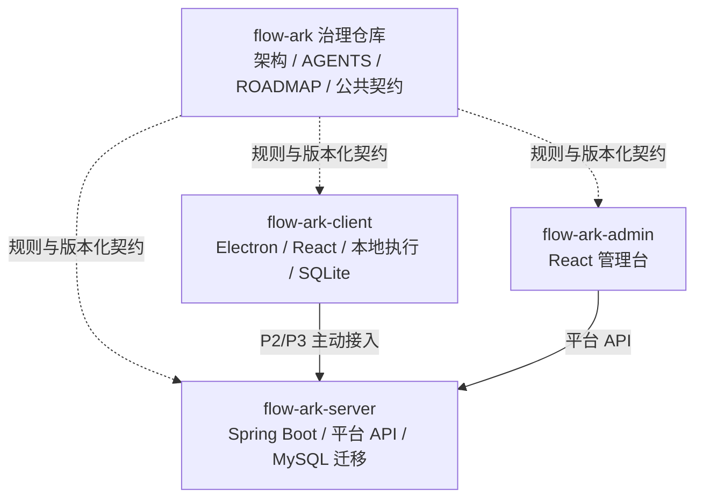
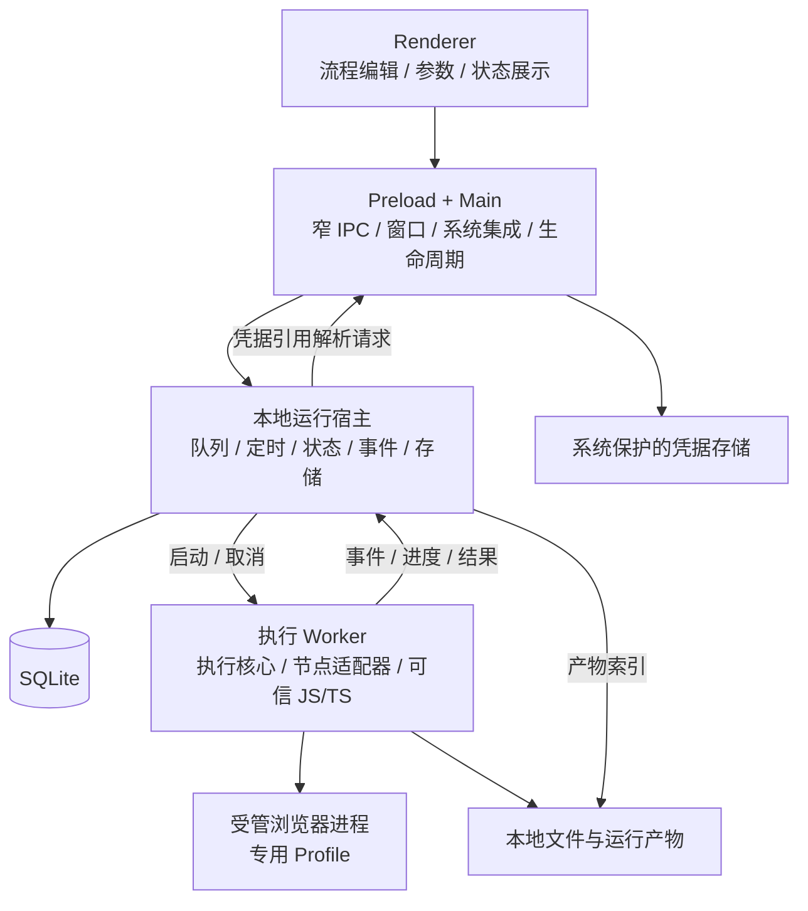
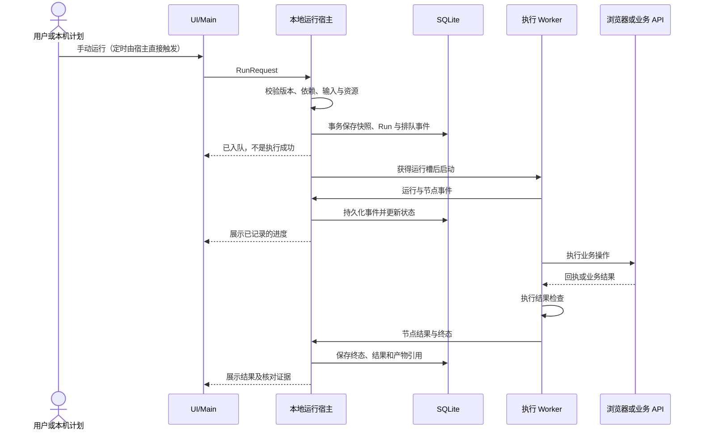
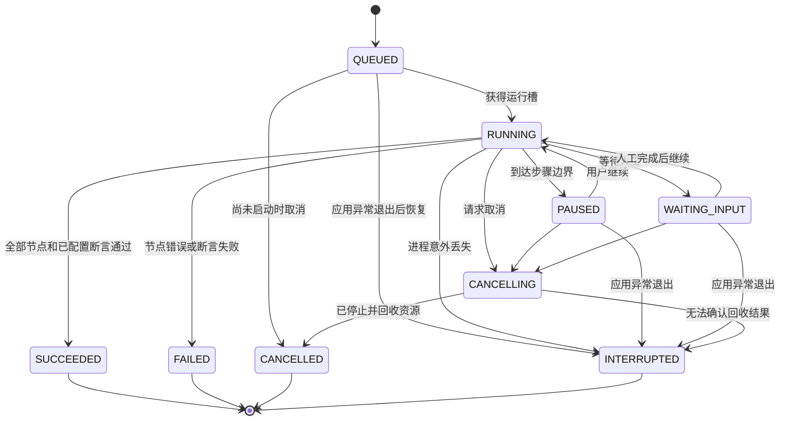
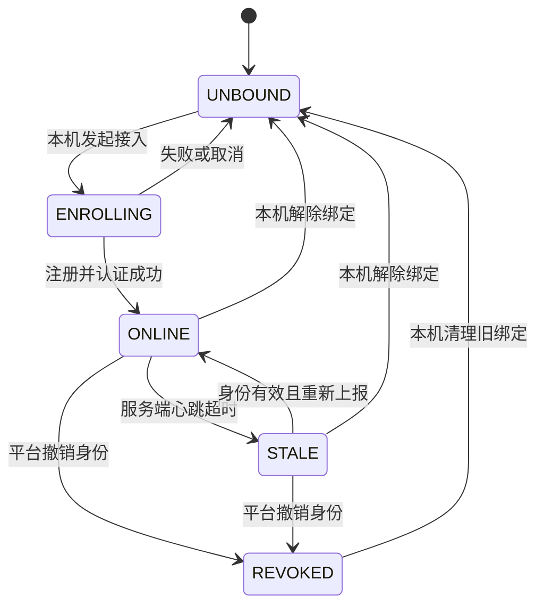

# FlowArk 总体架构

文档基线：P0，2026-09-16。状态：已确定的设计基线；应用工程、机器可读协议和平台均未实现。

本文是完整架构的唯一来源。[ROADMAP](../ROADMAP.md) 记录阶段与验收，[AGENTS.md](../AGENTS.md) 规定开发约束，[契约说明](../contracts/README.md) 规定协议版本与消费者管理。

## 1. 产品目标与阶段边界

FlowArk 是本地优先、可扩展的自动化工作台。用户通过可视化节点和可信自定义脚本，将数据处理、文件生成、浏览器操作和业务结果检查组合为流程。

| 阶段 | 交付目标 | 不据此承诺的能力 |
| --- | --- | --- |
| P0 | 多仓库治理、架构、开发约束、路线图 | 可运行客户端、可用协议、安装包 |
| P1 | Windows/macOS 单机客户端，手动和本机定时执行 | 服务端、管理台、远程派发、桌面自动化 |
| P2 | 单组织私有部署平台，集中监控设备与运行 | 远程执行或终止、平台调度 |
| P3 | 发布流程版本、设备授权、远程派发和治理 | 任意远程 Shell、任意本地文件访问 |
| P4 | 按需增加 Python、OCR、桌面操作、录制、插件、独立代理 | 一次实现全部扩展或自动跨平台兼容 |

P1 验收链路：**拉取数据 → JS/TS 处理 → 生成 Excel → 浏览器上传 → 核对业务结果**。不部署 FlowArk 平台也必须可以运行；访问业务网站和接口仍取决于业务网络。

## 2. 仓库组织与技术方向

`flow-ark` 是治理仓库和本地工作主目录。`flow-ark-client`、`flow-ark-server`、`flow-ark-admin` 是被主仓库忽略的独立子仓库，不使用 submodule。

图中治理连线表示设计和发布依赖，不是运行时调用。应用运行、构建、测试不能要求相邻仓库存在。

| 层次 | 选型 | 归属 |
| --- | --- | --- |
| 客户端界面 | Electron、React、TypeScript、React Flow、Monaco | 客户端仓库 |
| 自动化和文件 | Playwright、JS/TS 执行、ExcelJS | 客户端仓库的适配器 |
| 本地数据 | SQLite、独立文件目录、系统保护的凭据存储 | 客户端仓库 |
| 平台服务 | Spring Boot、MySQL、模块化单体 | 服务端仓库 |
| 管理台 | React、TypeScript | 管理台仓库 |
| 协议 | JSON Schema、OpenAPI、脱敏示例 | 治理仓库 |

客户端和管理台分别使用 pnpm 与各自锁文件；服务端使用 Maven。主目录不建立跨仓库 pnpm workspace。客户端可以在自身仓库内部组织多个包，执行核心暂不拆成第四个应用仓库。

SQLite 迁移由客户端发布，MySQL 迁移由服务端发布，不建立数据库专用空仓库。P2 不引入微服务、SaaS 多租户、计费、Redis 或消息队列作为基础前提。

具体依赖版本与目标系统最低版本在各应用首次建工程时验证并锁定，不使用 P0 文档虚构“最新兼容版本”。P1 必须有 Windows、macOS 两端验证记录；旧 Windows、IE 和 Linux 不在本轮承诺中。

## 3. 客户端进程与模块边界

Main 启动和监督本地运行宿主，宿主启动每次运行的 Worker。P1 单设备最多运行一个 Worker；Electron 专属进程启动与通信放入宿主适配层，不污染执行核心。首次实现可以用 Electron utility process 承载本地宿主，但其业务模块保持可由其他 Node 宿主加载。

| 模块 | 允许职责 | 禁止依赖或行为 |
| --- | --- | --- |
| Renderer | 编辑、表单、日志与进度展示 | 直接读写 SQLite/文件、读取凭据、启动进程或执行脚本 |
| Preload | 暴露明确方法及事件订阅 | 将完整 ipcRenderer、任意 channel 或原生对象交给界面 |
| Main | 系统窗口、文件选择、安全存储桥接、宿主生命周期 | 执行流程、业务节点、分支循环或定时业务逻辑 |
| 本地运行宿主 | 运行准入、队列、调度、事件和状态持久化、统一存储写入 | 在界面中直接暴露数据库，执行耗时用户脚本 |
| 执行核心 | 状态与控制流、输入输出、节点调度、取消传播 | React、Electron UI、平台 HTTP 客户端、具体 SQL 驱动 |
| 能力适配器 | 实现 Browser/HTTP/File/Excel/Script 等能力 | 绕过宿主修改运行记录或自行宣布平台任务完成 |

Renderer 配置 `contextIsolation: true`、`sandbox: true`、`nodeIntegration: false`。主进程校验 IPC 来源、方法和参数；文件操作用明确的业务接口，不暴露“执行任意命令”桥。受管业务网站运行在 Playwright 管理的浏览器中，不作为拥有本地权限的客户端 UI 加载。[Electron 安全指南](https://www.electronjs.org/docs/latest/tutorial/security)

Worker 及其所属浏览器/脚本进程必须可取消和回收。用户脚本不能与 Renderer 或主进程同进程执行；独立进程只提供故障与生命周期隔离，不是对恶意代码的安全保证。Node `vm` 不作为安全沙箱。[Node.js VM 文档](https://nodejs.org/api/vm.html)

## 4. 流程、节点和脚本模型

### 4.1 流程定义与执行版本

- 草稿可编辑，运行前校验并生成不可变执行快照；手动运行和定时运行都绑定该快照。
- 定时任务固定引用某个版本，更新草稿不会改变已启用计划；用户更新计划时显式选择新版本。
- `FlowDefinition` 描述执行语义，画布坐标、颜色、折叠状态属于独立编辑元数据。禁止将 React Flow 原始状态直接当成唯一执行协议。
- P1 支持顺序、条件、串行循环。循环必须使用显式容器，输入为集合或明确次数；不支持任意回边、并行分支和可复用子流程。
- 条件分支结果显式汇合；循环变量在迭代作用域内，跨节点数据通过输出引用传递。运行前校验不存在的引用和作用域越界，不依赖共享可变全局变量。
- 普通配置只使用明确的数据引用与条件操作，不通过 `eval` 执行表达式；复杂逻辑交给显式脚本节点。
- 活跃浏览器、进程、函数不能写入流程 JSON；文件用 `ArtifactRef`，浏览器会话用运行期引用，凭据用 `CredentialRef`。

### 4.2 P1 节点与 SDK

| 能力 | 最小行为 |
| --- | --- |
| HTTP | 请求业务数据，区分网络异常、HTTP 错误和业务结果 |
| JS/TS | 执行可信脚本，输入输出、日志、主动进度、取消；TS 在执行前编译 |
| Excel | 读取/写入普通工作簿与模板，记录文件产物；宏及高级公式计算不作为 P1 保证 |
| 文件 | 在用户选择或任务配置的范围内读写、归档，记录产物引用 |
| 浏览器 | 启动会话、定位、点击、输入、等待、读取、上传、下载和截图 |
| 结果断言 | 校验回执、状态或数量，业务不符合预期时失败 |
| 等待人工 | 等待用户处理登录/验证码或作出流程需要的输入，再继续 |
| 条件/循环 | 基于明确输入执行分支或串行迭代，记录节点实例与迭代位置 |

脚本接口包含 input、输出结果、logger、progress、artifact、credential 和取消信号等职责。函数命名和准确字段在 P1.1 契约中固定；不得伪装成现有 SDK。所有节点与脚本共享运行上下文和同一事件入口。

脚本依赖在运行前解析并固定，版本与依赖清单随执行快照记录；执行中不自动联网安装。P1 先提供内置 SDK 和经用户配置、验证的本地依赖，不建设插件市场。必要资源缺失时在启动前阻止运行，并给出明确原因。

脚本应主动报告业务进度，例如已处理数和总数。没有报告时展示当前节点、耗时和日志，不推算虚假的百分比。分支和循环流程的节点数量不能直接当成业务完成率。

### 4.3 浏览器与人工接管

P1 支持由客户端启动的 Chromium、已安装的 Chrome/Edge，并维护专用 Profile。每个 Profile 只能被一个任务占用，运行结束释放会话和锁；不复用用户日常默认 Profile。

浏览器是否安装、版本与运行能力在启动前检查。浏览器运行时的获取和分发方案在 P1.1 工程锁版时记录，不让每次流程执行临时安装浏览器。不同浏览器和系统的能力必须分别验证。[Playwright 浏览器说明](https://playwright.dev/docs/browsers)

P1 不承诺接管任意已打开浏览器窗口。未来 CDP 连接适配器需独立定义限制；CDP 仅适用于 Chromium 系浏览器，能力与完整 Playwright 协议不同。[Playwright CDP 说明](https://playwright.dev/docs/api/class-browsertype#browser-type-connect-over-cdp)

等待人工保留当前运行及浏览器会话，用户继续后执行下一步。P1 不自动识别验证码，不将 RPA 操作或未来桌面微信适配描述为不会封号。

## 5. 本地执行、状态与可靠性

### 5.1 从提交到完成

调度与 UI 走同一运行准入入口。宿主是 SQLite 的统一写入方，Worker 只发送事件。快照、初始记录和入队事件成功持久化后才能启动；终态持久化后才能对外报告已记录的完成。

状态和事件保持一致，不让 Worker 直接改数据库。宿主无法持久化时停止接收新运行，并报告本地故障；不得继续显示任务已可靠保存。已执行外部操作但尚未落盘的结果按未知处理。

### 5.2 运行状态

下面是 P1 的逻辑状态，正式 wire 枚举由 P1.1 Schema 固定，含义不得悄悄变化。

- 暂停请求在下一步骤边界生效，不承诺冻结任意脚本指令；等待人工和暂停期间仍占用运行槽及已持有的浏览器资源。
- 节点超时或已捕获异常记录失败；进程意外丢失、无法确认执行进度记录中断。异常恢复不自动重新执行排队或活动任务。
- 取消先传递协作信号，超过明确配置的宽限期后终止进程树；只有确认资源回收才记为已取消。
- 取消、中断、节点失败都不能证明外部操作没有生效。涉及提交的节点要保留回执或标记业务结果待核对。
- `SUCCEEDED` 表示流程中所有实际执行的节点和已配置检查通过；未配置业务检查时，不能宣称外部业务已验证成功。UI 同时表达执行结果和业务核对状态。
- P1 不做崩溃后的脚本内部续跑。用户核对后重新运行会产生新的 Run，并保留与原 Run 的关联。

### 5.3 调度、并发和副作用

- P1 每设备一个运行槽，手动任务 FIFO 排队。被暂停或等待人工的任务不会让出槽位。
- 本机定时仅在应用驻留时生效。计划记录时区和预期触发时间；同一触发时刻只能生成一次任务。
- 同一定时计划已有排队或运行实例时跳过本次触发，并记录占用原因，不积累同一任务的待执行副本。
- 退出、休眠期间的计划不补跑。恢复时记录错过的时间范围或次数，计算下一次未来触发，不伪造历史 Run。
- 关闭窗口进入托盘；显式退出停止调度，清楚提示受影响的运行，按取消规则处理活动任务并取消尚未执行的队列。
- 不自动设置开机启动或安装系统服务，应用退出后不会继续定时执行。
- 默认无自动业务重试。查询等可重复节点允许显式配置有限重试；提交、发布、上传后的业务确认等节点需要幂等证明或先核对状态，不能盲重试。
- 浏览器 Profile、未来桌面鼠标键盘等资源通过资源管理接口申请；不得由节点自行突破单任务约束。

## 6. 本地数据与安全存储

以下是逻辑数据集合，不是已经实现的表名或 DDL。P1.1 制定具体模型与迁移后再建立数据库。

| 数据 | 保存方式与归属 |
| --- | --- |
| 本地安装标识、设置 | SQLite；安装标识不等于未来平台设备 ID |
| 流程草稿、不可变版本、编辑元数据 | SQLite；语义和展示分开 |
| 本机计划、触发记录、跳过记录 | SQLite；保存版本引用、时区和触发依据 |
| Run、节点实例、迭代位置、RunEvent | SQLite；事件与状态由宿主统一写入 |
| 日志与产物元数据 | SQLite 保存索引；较大文件位于每次运行的产物目录 |
| Excel、下载文件、截图 | 本地文件目录；由 ArtifactRef 标记归属和内容信息 |
| 浏览器 Profile、登录态 | 专用本地目录；不放流程 JSON、不提交或默认上传 |
| 业务凭据与未来设备令牌 | 系统安全存储，或经系统能力保护的加密存储；SQLite 仅保存引用 |

数据目录位于用户数据区，不放源码仓库。运行产物按 Run 隔离，支持历史保留和清理；不能在仍需核对结果时无提示删除证据。

数据库迁移由本地宿主启动时执行并校验。破坏性结构变更提供备份和迁移说明；迁移失败时阻止新的运行，不能删除数据库“自愈”。升级后的历史数据和进行过业务提交的记录都必须可核对。

凭据读取经受控桥接按引用解析，明文不返回 Renderer，平台不持有浏览器登录态。系统安全存储不可用时阻止相关凭据能力，不能明文降级。

日志、异常和上报共用脱敏策略。任意可信脚本仍可能打印业务秘密，因此不能将自动脱敏宣传为绝对防泄漏。截图只在可采集时保存；采集失败不能掩盖原始错误。

导入导出包含流程、版本化脚本/依赖声明及显式选择的模板资源；默认排除凭据、登录态、运行历史和完整本地路径内容。导入后校验格式、能力和依赖并重新绑定本机资源，不自动执行导入脚本。

## 7. 跨系统数据归属与平台职责

| 对象 | 权威来源 | 平台与设备的关系 |
| --- | --- | --- |
| 本地草稿、流程、本机计划 | 客户端 | 默认留在本地；上传或纳入监控须有明确设置 |
| 平台发布的流程版本 | 服务端 | 设备只缓存不可变执行副本；本地修改另存为本地流程 |
| 平台任务与平台计划 | 服务端 | 设备接受后产生实际 Run；平台任务不能替代执行证据 |
| Run 实际事件和业务结果 | 执行设备 | 服务端通过事件投影形成监控记录，接收时间与发生时间分开保存 |
| 用户、角色、设备分组、授权审计 | 服务端 | 管理台通过 API 操作，服务端实施权限校验 |
| 本地凭据与浏览器登录态 | 客户端 | 平台只引用需求和绑定状态，不同步明文或 Profile |
| 运行附件 | 客户端产生 | 明确开启后上传副本；服务端使用自身附件标识，不能解析本地绝对路径 |

MySQL 和 SQLite 各自服务本端业务模型，禁止全库同步。平台端存储的状态是观察或管理视图，不通过写 MySQL “纠正”设备实际结果。

平台角色至少区分管理员、操作员、只读观察者。P2 管理员可管理账号和设备接入，观察者只读；P3 操作员在授权范围内发布/派发或取消，所有权限由服务端校验并审计。平台角色不替代设备对具体版本的本地授权。

P2 采用单组织私有部署：一个平台实例服务一个组织，设备与数据归属该平台。不建设租户切换、跨组织共享或 SaaS 配额。平台 API 与管理台可由同一部署入口提供，管理台仍是独立构建的仓库。

## 8. 设备接入、监控与远程治理

### 8.1 P2：接入与监控

设备经本机用户主动接入，平台验证一次性注册凭据并签发可撤销的设备身份。业务账号凭据与设备连接身份分开；设备令牌存入本地安全存储，不绑定某次浏览器登录。

一个安装同一时间只绑定一个平台。解除绑定或切换平台时，旧平台待上传事件、令牌和命令按旧绑定隔离，不能误发给新平台；本地流程与运行历史仍保留。

设备主动通过受认证的 HTTPS 接口注册、心跳与批量上报，不要求用户电脑开放入站端口。P2 先用心跳和批量事件接口实现监控，管理台通过服务端查询；无需为预留能力先建立长连接基础设施。

设备连接状态示意：

`ONLINE/STALE` 是平台根据接收情况判断的连接状态，不是 Run 状态。设备是否忙碌、等待人工、失败是另一维度。平台不能从失联推断断电、断网或程序故障的具体原因。

P1 先建立本地运行事件；P2 增加按绑定隔离的待上报队列与确认游标。事件允许重复投递，使用绑定身份、Run 标识和事件序号去重，确认持久化后才能推进游标。乱序到达不能覆盖更新的状态，缺口保留为待补齐，终态不因迟到旧事件退回运行中。

本地运行仅按启用的监控范围上传必要元数据；日志、截图、文件等附件单独配置。P2 没有远程启动、取消或平台计划，管理台只能观察实际运行。

### 8.2 P3：发布、授权与命令

平台发布流程版本后，设备下载并检查完整内容与能力要求。本地用户授权以下组合：流程版本及内容摘要、脚本与依赖声明、需要的凭据绑定、允许的参数范围。任一执行内容变化需要新版本和重新授权。

凭据引用只能使用该版本已批准的绑定，平台任务不能通过参数替换为任意凭据、文件路径或脚本。参数约束是运行准入条件，不是对恶意代码的沙箱。

设备继续主动使用认证 HTTPS 请求拉取命令并提交回执。命令至少关联唯一标识、目标设备、任务、流程版本和有效期；准确 wire 字段在 P3 契约中定义。

命令处理顺序：持久化收到记录 → 验证目标、版本、授权、参数、能力和有效期 → 持久化接受或拒绝 → 入队 → 开始执行 → 记录实际结果。命令与 Run 的创建关联必须原子记录，重复命令返回既有处理记录，不生成第二个 Run。

设备存储的去重信息需要覆盖命令可重投的有效窗口。设备丢失去重数据或业务执行结果不明时不得自动重跑。协议层去重不承诺外部业务副作用“恰好一次”。

平台取消命令只表示请求，必须等待设备确认执行与回收结果；离线时显示待送达。平台端身份撤销阻止后续连接和新命令，不宣称能立即终止断网设备上已经开始的任务。

断网期间已开始的任务继续按本地规则运行，新远程任务不能凭空启动；重连后补报实际结果。平台不因超时自动转派可能已提交业务的任务；核对后重试建立新的任务记录和明确关联。

本机计划和平台计划分别管理，各自引用确定的流程版本，不自动互相转换；本地和远程任务进入同一个设备资源管理与执行入口，远程任务不能抢占正在执行的本地任务。

## 9. 公共接口与演进原则

以下名称表示职责边界，不表示 P0 已存在可调用 API。

| 契约 | 最小职责 | 首次落地 |
| --- | --- | --- |
| FlowDefinition / FlowVersion | 格式版本、节点、控制结构、输入输出、能力要求、不可变执行内容 | P1.1 |
| NodeDefinition | 节点类型与版本、配置与输入输出描述、能力要求 | P1.1 |
| NodeExecutor | 执行上下文、结果、事件、取消；属于运行接口，不是可序列化函数 | P1.1 |
| RunRequest / RunSnapshot | 来源、版本、参数、触发依据、状态和业务核对结果 | P1.1 |
| RunEvent | Run、事件序号、节点实例/迭代位置、发生时间、进度、错误 | P1.1 |
| ArtifactRef / CredentialRef | 有明确归属的文件和凭据引用 | P1.1 |
| DeviceCapabilities | 系统、执行器版本、节点/浏览器等实际支持能力 | P1.1 本地检查；P2 上报 |
| PlatformConnector | 注册、心跳、事件补报、命令接收的边界 | P0/P1 只记录边界；P2/P3 实现 |

准确字段、错误码和消息限制随功能阶段补齐，遵循 [契约管理](../contracts/README.md)。本地 IPC、数据存储实体、平台 HTTP API 不强制合并为同一种接口。

公共契约使用 JSON Schema/OpenAPI，不以共享 TypeScript 包作为 Java 与前端的唯一联系。消费者固定契约版本，在自身仓库生成或纳入所需产物。升级需要兼容验证，不允许运行时读取主目录。

未来 Python、OCR 和桌面操作通过能力适配器增加；缺失能力应在运行前识别。桌面操作依赖目标系统、用户会话和权限，客户端支持某系统不代表桌面控件能力已适配。

未来独立执行代理复用执行核心和存储/事件接口，并单独实现宿主生命周期；P1 不安装它，也不承诺退出应用后运行。GUI 自动化所需的交互会话不能由“安装系统服务”这一动作自动解决。

## 10. 架构决策记录

| 编号 | 决策 | 原因与影响 | 演进约束 |
| --- | --- | --- | --- |
| A-001 | 治理仓库＋独立应用子仓库 | 统一方向，同时独立构建发布 | 无 submodule、跨目录源码或根依赖 |
| A-002 | 本地优先，平台可选 | P1 不需部署服务端 | 接入平台不取消单机能力 |
| A-003 | Node 执行核心与 Electron 宿主分离 | 支持隔离执行和未来代理复用 | 不为独立代理提前增加常驻服务 |
| A-004 | SQLite/MySQL 分别建模 | 本地执行与平台治理的写入权不同 | 通过契约交换业务事件，不做全库同步 |
| A-005 | Schema/OpenAPI 作为跨语言来源 | Java 与 TypeScript 需要同一协议依据 | 版本化、独立消费者验证 |
| A-006 | P2 先监控，P3 再命令 | 先证明可观察性，再引入远程副作用 | 不以心跳接入当成远程执行授权 |
| A-007 | 已授权版本才可远程自动执行 | 平台治理与本机执行权分离 | 内容变化重新授权，参数不能绕过绑定 |
| A-008 | 未确认副作用不自动重放 | 失败、中断、失联无法证明业务未提交 | 新运行需核对原结果，保留审计关联 |

以上为 2026-09-16 首次基线，没有既有应用数据需要迁移。后续决策追加日期、替代关系、迁移方式和对各仓库的影响，不悄悄覆盖历史含义。

## 11. 验证依据与参考

具体验收场景与完成状态维护在 [ROADMAP](../ROADMAP.md)，避免在本文另建一份进度表。P0 只验证文档、链接和仓库边界；流程、安装包和设备协议由相应阶段验证。

官方参考（用于理解能力与限制，不代表应用已经集成）：

- [Electron 安全指南](https://www.electronjs.org/docs/latest/tutorial/security)、[进程模型](https://www.electronjs.org/docs/latest/tutorial/process-model)。
- [Node.js VM 安全边界](https://nodejs.org/api/vm.html)。
- [Playwright 浏览器支持](https://playwright.dev/docs/browsers)、[CDP 连接限制](https://playwright.dev/docs/api/class-browsertype#browser-type-connect-over-cdp)、[登录态保护](https://playwright.dev/docs/auth)。
- [React Flow 文档](https://reactflow.dev/learn)。
- [JSON Schema 2020-12](https://json-schema.org/draft/2020-12)、[OpenAPI 3.1.1](https://spec.openapis.org/oas/v3.1.1.html)。
