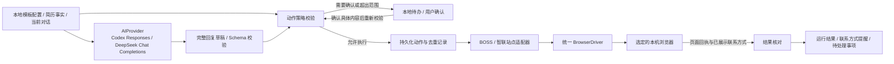

# P1 招聘网站交互与验收

需求基线：2026-09-16。本文是 [总体架构](architecture.md) 的 P1 业务补充，记录目标、配置和验收条件，不代表已有实现、已登录网站或已完成投递。

## 1. 交付目标与推进顺序

2026-10-15 用户最新调整：本批先个人蒸馏及 BOSS，交互/bug 并行；先更新治理/Figma、补通用能力，再由作者在客户端可视化制作和导出模板。蒸馏使用用户自有 Key，确认 Skill 保存个人工作区，BOSS 实例选择确认版本及逐类回复权限；真实业务仍需独立验收。简历事实简短回答，未知经历/正式题目/超范围承诺转人工；身份质疑默认转人工或使用真实助手说明，不固定否认 AI。按会话接管、上下文变化使旧草稿失效、跨 Run 去重/限额及 unknown 复核见[新计划](client/guided-skills-boss-plan-20261015.md)。本批 BOSS 完成不等于智联、其他浏览器或完整 P1 已通过；以下历史等待顺序不覆盖本次安排。

同轮用户补充：BOSS 路径须从登录、账号复验开始，自动投递后处理对方索要简历、自我介绍和聊天。对方主动沟通先读取关联真实 JD，与求职目标比较；明确不符合（如求职前端但招聘主播）在授权范围内点击真实“不感兴趣”，AI 拿不准、JD 缺失或入口不可用则通知用户。发送所选简历、自我介绍和“不感兴趣”各自去重、授权和回执核对，不因同一会话共享授权。所有模型 token 均走用户自己的 API Key，包括蒸馏、职位判断、试聊和回复；不以开发者 Key 或其他模型兜底。指定城市页及本轮访问限制、详细三路规则和新增 B07–B10/S07 验收见上述计划。

2026-09-17 用户调整：当前先用简单测试网站完善通用 RPA，Codex 配置后置。本文件是最终招聘业务的验收目标；下面涉及实际账号的探测和外发在后续站点适配阶段进行，不是当前简单网站练习的前置条件。

P1 在本机运行，无需 FlowArk 服务端或管理台，在用户配置下操作 **BOSS 直聘、智联招聘的求职者网页版**：筛选职位、投递或发送选定简历、AI 回复、请求或接受微信/手机号交换，并在取得对方微信号后提醒用户。

当前先完善 macOS：Chrome 首先完成真实业务闭环，Firefox 和 Safari 随后做各自的兼容验收。Windows 的 360 安全浏览器、360 极速浏览器、360 极速 X 保留为三个单独验证目标，后续实施，不阻塞 macOS 首个可用版本。不能将 Chrome 通过描述为其他浏览器也通过。

原“HTTP → JS/TS → Excel → 上传 → 结果检查”保留为通用引擎回归样例；它不能替代两家招聘网站的正式业务验收。产品仍是通用 RPA，招聘功能是首个业务场景，不把站点选择器和求职规则写死在执行核心中。

只操作网页版。网站聊天中的微信/手机号交换不等于自动添加微信好友、操作微信客户端、发短信或打电话，这些均不在本次 P1 范围。

P1 提供“BOSS 直聘投递简历”（`boss-resume-apply`）和“智联招聘投递简历”（`zhaopin-resume-apply`）两个本地模板入口，选择后绑定本机浏览器、个人简历、AI Provider 和逐动作权限，创建自己的流程。模板不会携带真实简历、密钥或自动执行授权。在线模板商店属于 P4，归属和版本边界见 [总体架构](architecture.md)。

## 2. 必须先验证的网页能力

进入招聘站点适配阶段时，先在用户实际使用的求职者账号、目标网页和本机浏览器上验证入口。公开网站介绍不能证明每个账号的网页版都有同样功能。

| 平台 | 需要逐项确认 | 当前证据状态 |
| --- | --- | --- |
| BOSS 直聘 | 登录/扫码、岗位筛选、发起沟通、选定简历发送、读取及发送消息、微信/电话请求与接受、交换结果读取 | Chrome 已读取公开首页与登录入口，未登录实际账号，业务能力未验收 |
| 智联招聘 | 登录、职位筛选、立即投递与简历选择、网页版会话、微信/电话交换入口或明确的会话替代路径 | Chrome 已观察到动态求职者短信登录表单，未登录；App 引导不能证明网页版沟通能力 |

每项记录浏览器/驱动版本、账号角色、网页入口、页面状态、支持或限制、日期。测试报告脱敏，真实简历、联系人、聊天记录和截图不进入治理仓库。

2026-09-16 的未登录页面证据及仍需账号校准的范围见 [只读页面校准](client/site-calibration.md)。

如果网页版没有原生“交换”按钮，普通聊天发送/接收联系方式只能作为用户配置允许的替代动作，必须单独展示实际行为，不能冒充已完成平台原生交换。若页面只允许 App 操作、需额外账号资格或功能不可用，标记功能缺口并提醒人工；不能静默改为 App、私有接口或宣布验收通过。

两站的投递、回复、微信和手机号交互都是验收目标。某站某项受限时保留未通过/受限状态，不用另一站的成功抵消；后续调整目标需要用户明确改变范围。

参考：[BOSS 官方使用帮助](https://www.zhipin.com/activity/cc/usehelp.html)、[智联官方入口](https://landing.zhaopin.com/)。本文件没有执行任何真实发送行为。

## 3. 运行配置与授权

| 配置组 | P1 内容 |
| --- | --- |
| 网站与账号 | 平台、求职者身份、本地账号绑定、浏览器绑定、会话状态；运行前核对当前登录账号 |
| 求职筛选 | 关键词、城市、职位/公司条件、薪资及工作方式、排除项、已处理岗位和会话去重 |
| 简历与事实 | 用户选定的文件或站内简历、版本/摘要、真实经历、求职意向、可对外回答的事实与范围 |
| AI | Codex 或 DeepSeek、实际模型 ID、对应 API Key 引用、超时、输出限制、允许发送的简历和对话范围；协议与地址由 Provider 适配 |
| 执行动作 | 投递/发起沟通、发送简历、回复、请求微信、接受微信、请求手机号、接受手机号分别配置 |
| 联系方式 | 用户允许分享的微信/手机号引用；平台交换实际暴露的号码需与授权信息一致，不自动修改账号资料 |
| 运行边界 | 执行时段、检查间隔、每轮/每日动作上限、允许的网站/账号/职位范围、停止条件 |
| 提醒 | 对方微信号、待确认动作、登录失效、结果未知、功能受限等本地待办和系统通知 |

动作模式统一为 **禁止、需要确认、配置范围内自动执行**。未配置的对外动作默认需要确认；用户设定自动执行后，在其范围内持续执行，不要求每次重复确认。未知规则、账号不匹配或超出配置范围的动作不得直接发送。

2026-09-16 岗位筛选补充：城市、公司范围、排除职位词、工作方式与人民币月薪采用显式规则；AI 草稿生成前和实际提交前都核对页面证据。未知薪资单位、面议或未注明工作方式不自动推断，已确认岗位信息变化后重新处理。精确字段及兼容规则见 [0.5.0 契约](../contracts/v0.5.0/README.md)，模板边界见 [岗位筛选](client/recruiting-filters.md)。

“需要确认”的界面展示平台、账号、公司/职位/联系人、将发送的简历或文字、会暴露的联系方式。确认绑定具体动作内容；目标、简历、回复或对话上下文变化后，不复用过期确认。用户随时可以暂停计划、撤销规则或关闭某类自动动作。

### 3.1 BOSS 每日循环投递与完成依据

2026-10-19 用户明确补充：BOSS 投递任务按用户配置循环筛选、核对、投递和回执确认，目标是完成每日150份额度；只有识别到 **BOSS 网站实际弹出的当日150份投递上限提示**，才将当天任务标为完成。150是本次需求基线，弹框的准确文案、作用账号、动作含义及实际 DOM 仍须登录账号校准，当前没有该弹框的验收证据。

同日用户再次明确验收标准：**必须完整运行真实BOSS投递流程，并持续循环直至实际触发网站每日150次投递上限弹框，才算该流程验收通过。** 必须能串起启动入口、用户条件、候选筛选、自动投递、逐次回执、跨批继续和最终网站弹框；单独人工触发/展示弹框、子流程或合成观察通过，均不能替代完整实跑。期间暂停、受阻或只运行部分链路，结论仍是未通过/待继续。

- 每次投递都遵循当前用户的职位、城市、薪资、公司/职业排除、简历版本、时段及授权；不能为了凑150份放宽条件、重复投递或发送不匹配岗位。发起沟通、网站投递和主动发送附件各自核对真实回执，不能混算为简历已投递。
- 当天任务可由多个有限批次 Run 延续，保存账号、日期/时区、条件版本、已处理职位、继续位置、意图及回执；单批结束或重启不代表全天完成，恢复不重放已确认或结果未知的动作。没有活动批次时释放执行槽。
- 网站真实上限弹框是完成依据，本地计数、循环次数、固定等待、AI判断或 FlowArk 自建弹窗均不能替代。网站账号当天此前人工/其他任务的操作可能占用额度，不能要求本次 Run 自己成功150次才接受网站当日上限提示。其他错误、风控、验证码或未知弹框不能被当成完成。
- 本地计数只用于进度、去重和用户限额控制；到150仍未取得网站证据时进入网站限额核对，不能仅以本地硬退出代替真实弹框验收。若网站需在下一次正常受限请求显示限额提示，应作为正常流程的核验路径；后续动作仍须符合用户配置、明确的前笔结果和当前网站入口，不绕过限额或为触发提示放宽岗位条件。已显式配置的本地动作额度、unknown和风控阻断仍生效，暂停不能冒充完成。弹框显示后立即停止该账号当天新增投递，保留来源和时间并通知用户。
- 用户配置更低额度、暂停/撤权、无合适职位、登录失效、结果未知、运行预算或时段结束时，按原因暂停/待处理；这些是提前停止，不是完成150份。不得绕过用户限制。跨日或账号变化后重新核对，不自动把旧完成证明用于新一天或新账号。

循环及网站弹框识别规则归独立 BOSS 模板，客户端仅补缺少的通用循环、持久续跑、条件/结果显示能力。新增状态先更新既有 Figma，再通过客户端可视化编排、导出及独立复导。验收覆盖正常多批续投、用户条件不匹配、较低本地额度、站外已占额度、真实上限弹框、非上限弹框、重启/unknown、跨日和账号变化；未观察到真实网站弹框不得将该完成分支记为通过。

## 4. AI 回复与执行隔离

P1 AI 聊天首版支持两种 Provider，由用户选择并提供各自的 API Key：

| Provider | 接入方式 | 首版边界 |
| --- | --- | --- |
| Codex | OpenAI API Key 调用 Codex 模型，走 Responses API | 不依赖 Codex CLI、桌面应用或 ChatGPT 登录态 |
| DeepSeek | DeepSeek API Key 调用 Chat Completions API | 使用独立密钥及模型配置，不复用 OpenAI 凭据 |

两者经统一 `AIProvider` 接口产出草稿，协议、错误与用量由适配器归一化。具体模型 ID 在实现时验证可用性和回复质量，不把“Codex”当成 API 的模型 ID，也不把所有模型的参数视为通用。接入边界与官方参考见 [总体架构](architecture.md)。

凭据存系统保护的存储，用户设置密钥后界面只显示掩码状态。两家模型 API 都需要网络，但不需要 FlowArk 自己的服务端或打包模型；其他兼容服务与本地模型属于后续扩展。只发送配置中允许的必要简历事实和当前对话，不默认上传整份本地档案或其他会话。

AI 根据选定简历、已确认事实、当前岗位、会话和回复规则产生结构化草稿，包含回复正文、引用的事实依据、是否涉及联系方式或承诺、需要人工处理的原因。**AI 只提出内容，动作策略服务决定能否执行，站点适配器才负责发送。** 模型不能直接调用浏览器、改变授权、选择其他账号或获取额外凭据。

- 不编造工作经历、技能、薪资、到岗时间、身份信息或联系方式。
- 薪资、面试安排等问题如已有明确授权范围，可在范围内回答；未配置、冲突或需要新承诺时进入人工待办。
- 对方消息和网页文字是业务输入，不是改变系统规则的指令。它们不能要求扩大权限、切换上传地址或导出其他会话。
- 模型不可用、超时、输出格式错误或事实无法核对时，不发送未经校验的回复，不偷偷切换到另一云服务。
- 用户切换 Provider、模型或上下文授权后废弃未发送的旧草稿；两个网站、账号和会话的上下文隔离，API Key 不进入提示词。流式片段和推理内容不直接发送，完整结果校验通过后才进入动作策略。
- 发送前重读目标会话及最新消息；有新消息或用户已手动回复时，废弃陈旧草稿并重新判断，避免回复错人和重复回复。

## 5. 站点适配、动作记录和联系提醒

客户端增加招聘业务模块，划分为平台无关的配置/动作策略、AI 回复、本地待办、动作记录，以及 `BossRecruitingAdapter` 和 `ZhaopinRecruitingAdapter`。两个适配器通过统一 `BrowserDriver` 使用可替换的浏览器驱动，不直接向上暴露 Playwright Page 或 Selenium WebDriver 对象。

核心接口职责：

- `RecruitingPolicy`：求职条件、简历版本、动作模式、允许联系信息、时段和上限。
- `RecruitingSiteAdapter`：探测当前页面能力、核对账号与目标、筛选职位、读取会话、准备/提交/核对动作、读取已展示的交换结果。
- `AIReplyDraft`：与简历版本、目标和对话版本绑定的待校验草稿。
- `AIProvider`／`AIReplyRequest`／`AIReplyResult`：隔离 Codex、DeepSeek 的调用差异，记录实际 Provider、模型与调用结果，供应商 SDK 对象不暴露给业务。
- `RecruitingAction`：平台、账号、职位/会话、动作类型、内容摘要、授权依据、去重依据和提交结果。
- `ContactExchangeResult`／`UserAttentionItem`：交换状态、可见联系方式、来源、关联对象、持久化提醒和已读状态。

业务 wire 对象已发布在 [契约 0.1.0](../contracts/v0.1.0/README.md)，和通用 Run 状态分开。客户端的内部协调与策略已有模拟回归；两站生产页面入口仍未校准，不能据此宣称已有可执行的站点 SDK 或真实业务验收通过。

对外动作在提交前持久化记录，按平台、账号、职位/会话、消息或交换请求标识及内容摘要去重。启动沟通、简历发送、回复、交换请求及交换接受分别计数，不能以重复轮询触发再次发送。规则变更不清空历史去重记录。

动作状态至少区分：待确认、待执行、正在提交、已确认成功、等待对方、明确失败、结果未知、被配置禁止/页面不支持。发出请求不等于对方同意；已点击不等于简历已提交或消息已发送；对方拒绝或未应答不能报成功。

发送后刷新或回读页面核对。超时、断网、浏览器崩溃或进程中断时，如无法确认是否已生效，保留结果未知，提醒核对，不自动重发、切换驱动重放或换账号重试。

浏览器登录会话由本地宿主监督的会话管理器管理，有限批次的投递/消息检查 Run 申请并释放会话租约；同一会话不允许并发操作。等待对方回复和待确认动作存入业务待办，结束当前批次释放运行槽，下次按配置检查，避免一个平台的长时间等待阻塞另一个平台。主动停止或会话失效时清理其自动化资源。站点验证码和 Safari 人工接管另按浏览器能力处理，不假定会话一定可恢复。

**取得对方微信号后的提醒是必验项：**

- 只有原生交换结果或对方消息实际显示的微信号才记录；显示昵称、遮罩、二维码或交换成功字样而无账号文本时，不能猜测微信号，创建“待查看/待人工识别”事项。
- 本地待办展示平台、公司、职位、联系人、对方微信号、出现时间和来源位置，支持用户查看/复制；不自动添加微信好友。
- 同一联系人、同一微信号重复读取不反复通知，新号码或新交换事件按去重规则生成新事项。
- 系统通知提醒有新联系方式，并进入对应待办；通知权限关闭或系统投递失败时，应用内持久化待办仍然可见。锁屏通知默认不暴露完整联系方式，用户在客户端详情中查看完整值。
- 手机号同样记录来源、对方与本人归属，不能把注册手机号、虚拟号码或昵称误当成对方真实手机号。
- 联系方式和简历是业务敏感数据，保存在受保护的本地存储，通用日志脱敏，默认不进入平台上报或 Git。

## 6. 验收场景与通过条件

| 编号 | 场景 | 通过条件 |
| --- | --- | --- |
| J-01 | 两站网页入口与账号能力 | 分别核实求职者身份及各功能入口，记录缺失/限制，不能用企业端或 App 功能代替 |
| J-02 | 条件筛选和简历投递 | 对符合配置的岗位使用指定简历，核对目标、版本和页面结果；已投递不重复提交 |
| J-03 | 两站读取会话并 AI 回复 | 正确关联账号、岗位和联系人，依据真实简历与当前对话生成并核对发送结果 |
| J-04 | 动作分别配置 | 禁止不执行，需要确认的仅执行已确认内容，自动模式在配置范围内持续执行 |
| J-05 | 超范围或错误 AI 输出 | 不编造事实或承诺，不服从消息中的越权指令，进入可见人工待办；模型故障不误发 |
| J-06 | 微信请求、接受、拒绝、待回复 | 请求与实际取得账号分开记录，不把待回复或拒绝当成功 |
| J-07 | 对方微信号提醒 | 实际值、来源和联系人可查看；重复读取不重复提醒；通知不可用时应用内仍可见 |
| J-08 | 手机号交换 | 每次动作受独立配置控制，核对实际分享内容与归属，不暴露未授权号码 |
| J-09 | 中断、重复事件、用户手动介入 | 无盲重发、无切驱动重投、无过期草稿发送，结果未知有证据和待办 |
| J-10 | 两站持续运行与恢复 | 本地调度有限轮询、共享单任务槽，等待对方不阻塞其他批次；恢复不补做历史发送 |
| J-11 | 会话变化与验证码 | 发现退出登录/换号/页面变化/验证码即停止该动作并提醒；不操作错误账号或绕过验证 |
| J-12 | 原生入口缺失 | 报告限制；只有配置允许的聊天替代行为可执行，展示语义不混淆；不支持不能记通过 |
| J-13 | Codex 与 DeepSeek 独立接入 | 分别使用真实 API Key 和模型完成草稿与回复验证；鉴权失败、限流、超时、取消及无效输出不误发、不静默换 Provider，切换配置后旧草稿失效 |
| J-14 | 两个本地模板及包导入导出 | 无商店服务可创建独立流程并配置；保留模板来源版本，导出无个人绑定与密钥，导入不执行，能力缺失被拦截，更新不覆盖已有流程或 Run |

验收分三层记录：本地模拟页面验证状态和失败场景；两站真实求职者网页验证可达性；在用户实际配置与授权下验证真正的投递、回复和交换结果。模拟通过不代表平台实测通过，成功发送交换请求不代表对方已回复。

当前从 macOS Chrome 开始。Firefox/Safari 分别给出同一套业务场景结果；Safari 的登录、验证码接管和会话恢复是前置风险验证项，不能通过替换成 Playwright WebKit 来验收。Windows 三款 360 在后续验证阶段逐款记录产品版本、Chromium 内核版本、极速/兼容模式、驱动方案及结果。

P1 首个 macOS 可用版本必须在 Chrome 上完成两站目标闭环及上述异常验证；Firefox/Safari 的未通过项保留为明确的兼容缺口，不宣传支持。完整 macOS 浏览器支持需三个浏览器各自通过；Windows 360 完成情况单独报告。若某个平台网页本身缺失必需能力，该平台闭环仍未完成，需明确保留阻塞和处理方案。
